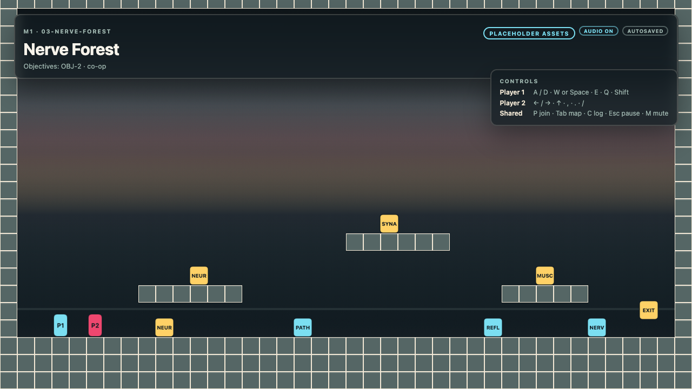
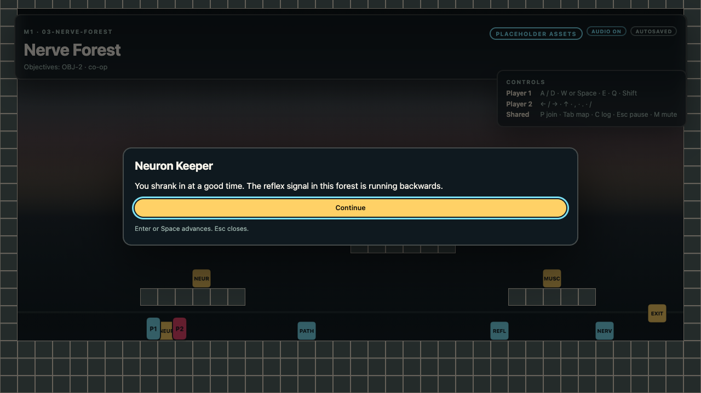
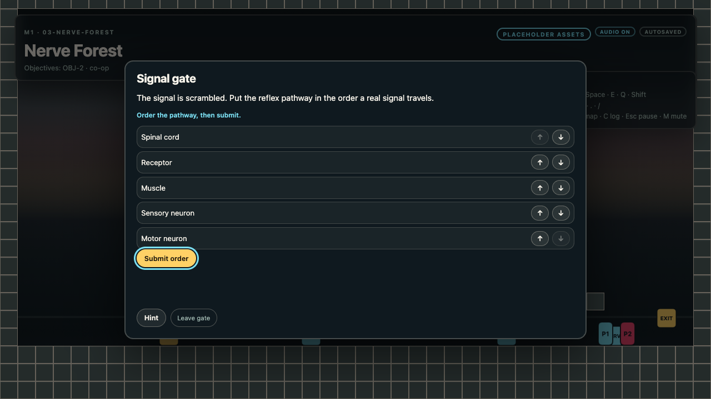

# Shrinkonauts M1.75 — Implementation Notes

M1.75 adds the feedback and effect layer on top of the M1 runtime. The app boots
directly into **03 — Nerve Forest**, plays the Node Run puzzle, transitions
through the debrief to **04 — Endplate Ferry**, and finishes the pack with
teach-back evidence export.

The M0.2 foundation and M1 runtime are preserved: placeholder-first assets, the
provider chain, the audio cue layer, fixed-step simulation, the DOM HUD, the pure
validator, autosave/restore, local co-op, and the browser smoke.

No final art or audio is included. Every anatomy asset ID resolves to a
procedural placeholder, and every cue resolves to a synth or silent fallback.

## Status

| Area | State |
| --- | --- |
| Direct boot into `03-nerve-forest` | Working |
| 03 → 04 transition through debrief | Working |
| Pack + syllabus loading from `public/` | Working |
| Entity conversations (P1/P2 concurrent) | Working |
| Dialogue graph (linear nodes, choices, effects) | Working |
| Concept scan and concept log | Working |
| Node Run and Endplate Ferry puzzles | Working |
| Capability feedback surfaces and attributed cues | Working |
| Beat progress and stuck hint/reset affordance | Working |
| Composable cosmetic effects and tile visuals | Working |
| Debrief, teach-back, evidence export | Working |
| Autosave + restore (`shrinkonauts.run`) | Working |
| Conversation save/restore + legacy dialogue migration | Working |
| Audio + accessibility settings (`shrinkonauts.settings`) | Working |
| Local co-op, tether, checkpoint P2 toggle | Working |
| Pause, text scale, reduced motion, mute, focus management | Working |
| Placeholder asset pipeline (44/44 anatomy IDs) | Working |
| Pure validator with injected feedback vocabulary | Working |
| Headless runtime smoke | Working |
| Playwright browser smoke on system Chrome | Working |
| Human solo/co-op playtest | **Pending** |
| Final art/audio | Deferred |
| Levels 5+, capture mode, music/ambience loops | Deferred |
| Full key rebinding | Deferred |
| Physical gate bodies, `locked`/`unlock`, conditional links | Deferred |
| Per-level debrief overrides, side-level travel | Deferred |

## Commands

Run from `shrinkonauts/`:

```bash
npm install
npm run dev             # http://127.0.0.1:5173/
npm test                # 29 files, 303 unit/integration tests
npm run smoke           # room boot + module boundary tests
npm run build           # tsc --noEmit + Vite production build
npm run pack:validate   # dev fixture + anatomy pack validation
npm run pack:map        # regenerate/check the mapping document
npm run pack:smoke      # dev simulation + headless runtime loop
npm run smoke:e2e       # Playwright, system Chrome, port 4173
npm run preview         # serve dist/
```

`smoke:e2e` starts Vite on port 4173 and launches Playwright with
`channel: "chrome"`. It uses the installed system Chrome and never downloads a
bundled browser.

Asset modes:

```text
/                  # anatomy pack, procedural placeholders
/?assets=fixture   # anatomy fixture manifest if present, else warn + placeholders
/?assets=final     # final manifest (current entries are placeholders)
```

Unknown `?assets=` values fall back to placeholder mode. The app does not boot
`public/content/dev`; that tree remains the regression fixture for scripts and
tests.

## Architecture

```text
platform ──> game ──> audio ──> assets
                  ├─> assets
                  ├─> syllabus
                  ├─> pack
                  ├─> progression
                  ├─> narrative
                  ├─> curriculum
                  ├─> save
                  ├─> feedback ──> ecs, puzzle
                  ├─> ui ──> feedback
                  └─> world ──> assets, pack, puzzle

pack ──> assets, core, puzzle, syllabus
progression, narrative ──> pack
curriculum ──> core, pack, syllabus
save ──> curriculum, progression, puzzle
```

| Module | Responsibility | May import |
| --- | --- | --- |
| `core` | `Result`, logger, event bus, shared event vocabulary | — |
| `ecs` | Deterministic entity/component/system kernel | `core` |
| `feedback` | Facts, director, descriptors, lexicon, beats, effects | `core`, `ecs`, `puzzle` |
| `syllabus` | Syllabus schema, parser, objective/concept lookups | `core` |
| `assets` | Logical IDs, manifests, providers, preload, placeholder fallback | `core` |
| `pack` | Pack/level/room/dialogue/gate/puzzle schemas, parsers, browser loader, pure validator, injected feedback vocabulary | `assets`, `core`, `puzzle`, `syllabus` |
| `progression` | Abilities, flags, gates, map reveal | `pack` |
| `narrative` | Dialogue traversal, choices, effects | `pack` |
| `curriculum` | Learning events, objective progress, debrief, evidence export | `core`, `pack`, `syllabus` |
| `save` | Versioned run slot, conversations, audio/accessibility settings | `curriculum`, `progression`, `puzzle` |
| `audio` | Cue playback, Web Audio, unlock, mute/volume, providers | `assets`, `core` |
| `ui` | HUD, overlays, anchored surfaces, live region, settings | `assets`, `core`, `curriculum`, `feedback`, `pack` |
| `world` | Phaser scene, fixed-step simulation, effects, tile visuals, input | `assets`, `core`, `pack`, `puzzle` |
| `game` | Runtime orchestrator, feedback integration, conversations, effect mapping, browser boot | all domain/adapters |
| `platform` | Browser entry point | `core`, `game`, `ui` |

`tests/boundaries.test.ts` enforces the graph: no Phaser or Matter outside
`world`, no media paths outside `assets`, no direct media imports in
gameplay/UI/audio/platform, `ecs` only depends on `core`, `feedback` only on
`core`/`ecs`/`puzzle`, `world` does not import feedback, `pack` does not import
feedback, and `ui` does not import puzzle internals.

Three deliberate seams keep the graph acyclic:

- `src/ui/model.ts` is the presentation contract. The runtime produces view
  models; the DOM renderer renders them. `ui` never imports `game` or `puzzle`.
- `src/world/runtime-port.ts` defines `WorldRuntime`, `RuntimeInput`,
  `WorldEffectPlan`, and tile ports. `RoomScene` depends on structural ports, not
  on `game`.
- `pack/validate.ts` receives `FeedbackValidationVocabulary` from scripts/tests
  instead of importing `feedback`.

The one documented dependency exception is `pack/validate.ts` importing
`../assets`. Validation must answer the same question the renderer asks — does
this logical ID resolve, and to what? Reusing `createAssets` and the shared ID
constants avoids a second resolver that could drift. The import is pure: no
file, DOM, network, or Phaser APIs are involved, and `fileExists` is injected
by the Node or browser caller.

## Runtime lifecycle

`src/game/runtime.ts` is a plain TypeScript orchestrator. It owns run state but
never touches the DOM, Phaser, Web Audio, localStorage, or asset files.

```text
start()
  └─ loadRun(packId, packVersion)
       ├─ valid save  → restoreRun()
       └─ none/invalid → newRun()

newRun()
  ├─ clearRun()
  ├─ abilities = ["scan"]
  ├─ clear curriculum, debrief answers, triggers, conversations
  ├─ activeP2 = true
  └─ enterLevel(startLevelId, fresh)

enterLevel()
  ├─ rebuild RoomSimulation
  ├─ place both players at the entry checkpoint (or restore positions)
  ├─ reveal the level's map node
  ├─ record pack_loaded / level_started / room_entered
  ├─ play the boot cue
  └─ autosave

restoreRun()
  ├─ restore progression + learning events + checkpoint + conversations
  ├─ restore both player positions
  ├─ status "debrief"  → enterDebrief(false)
  ├─ status "complete" → enterDebrief(false) + finish
  └─ toast "Resumed from checkpoint"
```

`step(dt, input)` advances the simulation, routes soft-surface input, drains
one-shot actions, checks checkpoints/triggers/exits, ticks the feedback director,
updates the stuck affordance, and returns gameplay cues (`jump`, `land`, `dash`).
Actions are latched by the input source, so an `E` tap is consumed exactly once
by the next fixed step even when several render frames occur first.

### State machine

`src/game/state-machine.ts` defines the only legal transitions:

```text
boot → level
level ↔ gate | map | conceptLog | pause
gate | map | conceptLog | pause → level
level → debrief → complete
any → error
```

Entity conversations are soft surfaces inside `level`; they are not a global
blocking state. `Esc` is a shared close action: it closes the map, concept log,
gate, or debrief-as-pause before toggling the pause overlay. Overlays are
blocking: the scene ignores movement while a non-level state owns input. The
runtime emits a snapshot only when it changes (deduplicated), which keeps DOM
updates cheap.

### The vertical slice

```text
03 spawn (checkpoint-entry)
  → Neuron Keeper conversation (dlg-neuron-01)
      ├─ correct choice reveals CON-3, CON-4, CON-5 and the map node
      └─ wrong choice loops to the retry node
  → optional scans (CON-3 … CON-7)
  → Node Run (puzzle-node-run)
      ├─ press both dendrite inputs
      ├─ reach the stimulus threshold
      ├─ latch the threshold gate
      └─ open the exit
  → exit → OBJ-2 teach-back → finish → 04
04 spawn (checkpoint-muscle-entry)
  → interact at the motor terminal (puzzle-endplate-ferry)
  → terminal plate starts the Ca²⁺ window
  → P2 carries ACh to the nicotinic receptor
  → P1 pulses from the terminal
  → Ca²⁺ gate + receptor relay open the latched muscle gate
  → AChE clears ACh
  → exit → OBJ-2 teach-back → complete → export evidence
```

`scan` is available from the start. `signal-dash` is granted by Node Run. Solo
play is the same flow with P2 inactive. Feedback surfaces are anchored to the
relevant entity/player, and cues carry P1/P2 attribution.

## Feedback and effects

`src/feedback/` is the presentation domain. It imports no DOM, Phaser, Matter,
`world`, `game`, `ui`, or `pack`.

- `facts.ts` maps puzzle events, action outcomes, conversations, and system
  outcomes to cue recipes or explicit silence.
- `descriptors.ts` defines exhaustive `NODE_FEEDBACK` and `LINK_FEEDBACK` tables,
  capability defaults, labels, and persistent state projection.
- `director.ts` owns the ECS-backed sticky surfaces, transient cues, beats,
  effect instances, ordering, dedupe, TTL, and cancellation.
- `effect-presets.ts` defines named cosmetic recipes built from the closed
  operator/path vocabulary.
- `beats.ts` derives authored or win-graph beat progress.

`GameRuntime` ingests facts and projects sticky surfaces once per fixed step.
`RuntimeSnapshot.feedback` contains surfaces, cues, beats, and effect instances.
The scene consumes only `WorldEffectPlan`/tile ports through `drainEffects()`.

### Accessibility contract

- Every surface and cue has non-empty text or an accessibility alternative.
- Every effect belongs to a surface/cue that carries text or a state alternative.
- Persistent state is never conveyed by animation or audio alone.
- Player-caused cues include actor attribution; `.feedback-live` announces it.
- Soft surfaces consume only their owner's input; P1 does not steal P2 input.
- Off-screen surfaces dock inside the safe area.
- Reduced motion simplifies movement effects into static markers/removals while
  preserving surfaces and text.
- Effects never mutate puzzle, world, or collision state.

## Pack and syllabus loading

`src/pack/load-pack.ts` is the browser loader. It fetches a pack directory,
resolves referenced JSON files, parses every document, and returns a structured
`PackContent` or a single error.

```text
public/packs/anatomy-reflex/
  pack.json                 start/end level, manifests, assets
  theme.json                palette, fonts, parallax, UI assets, audio cues
  mapping.json              concept → objective/level coverage
  licenses.json             licence entries
  assets.placeholder.json   placeholder manifest
  assets.final.json         final manifest (currently placeholder entries)
  levels/03-nerve-forest/
    level.json              objectives, concepts, puzzleIds, feedback, map, evidence
    room.json               tiles, entities, anchors, checkpoints, triggers, exits
    dialogue.json           graph, choices, effects
    gate.json               concept-gate puzzle, hints, onSolve/onFail effects
    puzzle.json             typed dataflow, hints, solution
  levels/04-muscle-effector/
    level.json, room.json, dialogue.json, gate.json, puzzle.json
public/syllabi/anatomy-reflex.json
```

Parsers reject unsupported schema versions, duplicate IDs, unknown references,
malformed tiles, unknown feedback keys, and cyclic prerequisites with a typed
error. `PackContent` exposes lookups (`levels`, `rooms`, `dialogues`, `gates`,
`puzzles`) and the parsed `Syllabus`.

The `pack` module also owns mapping generation and drift detection
(`npm run pack:map`) so concept/objective/level coverage stays consistent with
the authored JSON.

## Gate types

All three concept-gate puzzle types are implemented and evaluated in
`src/progression/index.ts`. 03 and 04 author a `sequence` gate.

| Puzzle | Answer shape | Evaluation |
| --- | --- | --- |
| `singleChoice` | `string` | equals `answerId` |
| `sequence` | `string[]` | exact ordered array equality |
| `match` | `Record<string,string>` | same key set and every value equals |

Gate state types (`ability`, `flag`, `concept`) are implemented as state checks.
Correct submissions record `gate_solved`, apply `onSolve` effects, and persist;
incorrect submissions record `gate_failed`, apply `onFail`, and show feedback
without closing the gate. Hints are stepped through with a bounded index.

Puzzle gates (`gate` nodes) are logical/latched state. Physical `puzzleGate`
bodies are an accepted but deferred target.

## Input and co-op

`src/world/input.ts` samples P1, P2, and shared keys. Keydown events are latched
into a set; the next fixed step drains each one exactly once. This replaces
`Phaser.Input.Keyboard.JustDown`, which clears on keyup and silently drops taps
shorter than a render frame (including Playwright's instant presses).

| Player | Move | Jump | Interact | Scan | Dash | Pulse | Carry | Throw |
| --- | --- | --- | --- | --- | --- | --- | --- | --- |
| P1 | `A` / `D` | `W` or `Space` | `E` | `Q` | `Shift` | `F` | `G` | `H` |
| P2 | `←` / `→` | `↑` | `,` | `.` | `/` | — | `'` | `;` |

Shared: `P` join/rest P2 at a checkpoint, `Tab` map, `C` concept log, `Esc`
pause/close, `M` mute. `Tab` is captured so focus cannot leave the game before
the map overlay takes over. `RoomScene` buffers the sampled frame until a fixed
step consumes it, so 120 Hz render loops cannot drop a press either. When a text
field owns focus, `discard()` clears latched actions.

Both players are active at boot. Co-op is not a separate mode: either player can
talk, scan, open a gate, or cross the exit. The tether keeps the pair within
560 px; when they separate further, P2 is pulled toward P1 so the shared camera
cannot lose a player. `P` only changes P2 at a checkpoint, and rejoining places
P2 beside P1 at that checkpoint. Soft-surface routing is owner-aware: hard
overlays consume all input; conversation/stuck surfaces consume only their
owner's (or shared) UI actions.

## Save format

`src/save/index.ts` owns both localStorage slots and all persistence.

```text
shrinkonauts.run        one versioned run snapshot (2.1)
shrinkonauts.settings   audio + accessibility settings (2.0)
```

Run snapshot additions in M1.75:

```json
{
  "schemaVersion": "2.1",
  "packId": "anatomy-reflex",
  "packVersion": "0.3.0",
  "contentVersion": "0.3.0",
  "levelId": "04-muscle-effector",
  "roomId": "room-muscle-effector",
  "checkpointId": "checkpoint-muscle-entry",
  "progression": {
    "abilities": ["scan", "signal-dash"],
    "flags": {},
    "solvedGates": [],
    "revealedNodes": ["map-nerve-forest", "map-muscle-effector"],
    "revealedEdges": ["..."]
  },
  "events": [],
  "elapsed": 0,
  "savedAt": "2026-10-28T12:00:00.000Z",
  "status": "playing",
  "players": {
    "activeP2": true,
    "bodies": {
      "p1": { "x": 144, "y": 640, "vx": 0, "vy": 0, "angle": 0, "angularVelocity": 0, "sleeping": false },
      "p2": { "x": 176, "y": 640, "vx": 0, "vy": 0, "angle": 0, "angularVelocity": 0, "sleeping": false }
    }
  },
  "world": { "bodies": {}, "props": {}, "puzzles": {} },
  "audio": { "muted": false },
  "conversations": [
    {
      "surfaceId": "conversation:p1:agent-neuron",
      "dialogueId": "dlg-neuron-01",
      "nodeId": "check",
      "owner": "p1",
      "entityId": "agent-neuron"
    }
  ]
}
```

`status` is `playing`, `debrief`, or `complete`. Loading rejects malformed JSON,
an unsupported schema version, a different pack ID, or a different pack version.
Settings clamp volume to `0..1` and text scale to `0.8..1.6`, and fall back to
defaults on corrupt data. Storage may be unavailable (private mode/no
localStorage); the save module then keeps working in memory.

Legacy single `dialogue` saves migrate to one P1-owned conversation. A missing
conversation entity/dialogue on restore closes the conversation with a recovery
cue. Feedback surfaces/cues/effects are never saved; they are rebuilt from state.
`returnTo` and side-level save state are deferred.

Autosave runs at level start, checkpoint changes, puzzle events, conversation
updates, debrief updates, and the player-2 toggle. It does not run after
completion. The audio module writes through `save.audioStorage`, so muting never
invents a second settings store.

## UI and accessibility

`src/ui/game-ui.ts` mounts a DOM HUD and blocking overlays; Phaser renders only
the room and effects. `src/ui/feedback-renderer.ts` renders anchored surfaces and
cues, beat progress, and the `.feedback-live` polite live region. Surfaces are
diffed by stable ID, sorted by priority, and laid out by anchor with safe-area
docking and P1/P2 caption lanes.

The accessibility baseline is:

- `Esc` pause from gameplay, with a visible pause overlay.
- Text scale presets (90–150%) applied through `--ui-font-scale`.
- Reduced motion: sets `data-reduced-motion="true"`, disables CSS animation, and
  simplifies movement effects while keeping surfaces/text.
- Mute toggle (`M`) from gameplay and from every overlay, with HUD status.
- Focus management: overlays are `role="dialog"`, `aria-modal`, labelled,
  autofocus the first meaningful control, trap `Tab`/`Shift+Tab`, and restore
  focus to the previous element on close.
- Owner-aware soft surfaces; P1/P2 can operate conversations concurrently.
- Live regions for toasts, gate feedback, and feedback cues with actor
  attribution.
- Semantic buttons and labels for gate reordering, choices, and debrief.

Full key rebinding is deferred. Settings changes update the mounted pause
overlay in place, so buttons reflect their new state without recreating the
DOM or losing focus.

## Asset pipeline

M1.75 preserves placeholder-first IDs. Gameplay, UI, audio, and feedback ask for
logical IDs such as `sprite.agent.neuron`, `bg.nerve_forest.mid`, or
`audio.cue.scan`; only `src/assets/` knows media paths.

```text
final manifest → fixture/pack manifest → placeholder provider
```

The anatomy pack declares 44 IDs and resolves all 44 to placeholders, including
the player sprites, tileset, parallax layers, agent/gate/scene sprites,
checkpoint, exit, and audio cues. `?assets=fixture` looks for an anatomy fixture
manifest; because none is authored for this slice, it warns and keeps
placeholders. The dev fixture still resolves 10/10 placeholders, or 7/10 with
its fixture manifest selected by the scripts.

The preload plan, validation, and boot fail loudly if an ID is unknown or a
referenced file is missing. `applyTheme` maps pack palette/fonts to CSS
variables, so placeholder art still respects the configured theme.

## Audio

Audio remains a replaceable presentation layer. Gameplay never reads audio
state; the runtime emits semantic cues and the boot adapter maps them to asset
IDs. Current cues are short:

```text
boot, dialogue, scan, dash, gate, map, debrief, checkpoint, unlock,
jump, land, wrong
```

Web Audio is unlocked on the first keydown/pointerdown, mute and volume persist
through the save-owned storage seam, and missing/failed media warns and falls
back to a synth or silence. Feedback lexicon audio IDs remain vocabulary
metadata; the current runtime continues to play the named theme cues. Music and
ambience loops are deferred.

## Validation

`src/pack/validate.ts` is pure: filesystem access is injected via `fileExists`.
It checks schema versions, duplicate IDs, missing level/room/dialogue/gate/puzzle
references, evidence rules, syllabus references, asset IDs and categories,
manifest files, licences for non-placeholder final entries, background layers,
audio/UI asset categories, theme tokens, mapping drift, and feedback content.

Feedback validation is injected because `pack` must not import `feedback`:

```ts
interface FeedbackValidationVocabulary {
  effectPresetIds: readonly string[];
  tilePathPreset: string;
  nodeEffectSockets?: Readonly<Record<string, string | undefined>>;
}
```

Errors: missing feedback puzzle/beat/node references, unknown effect presets,
missing tile layers, out-of-bounds or unordered tile targets, tile-path preset
without a target, missing vocabulary, and unknown theme cue names.
Warnings: tile target without the tile-path preset, empty puzzle hints, a
feedback override without a label, and a missing conventional `muzzle`/`mouth`
socket (the centre fallback is used).

For the two-level slice, forward references remain advisory warnings:

- exits/next levels targeting `05-reflex-core`;
- map edges to future map nodes;
- unattempted objectives and concepts.

`npm run pack:validate` currently reports those expected warnings for
`anatomy-reflex`, and passes both dev modes with no issues. `pack:map` checks
generated mapping drift, and `pack:smoke` asserts that all referenced anatomy
IDs resolve.

## Simulation and rendering

`src/world/simulation.ts` is the pure, fixed-step simulation: AABB tile
collision, gravity, jump/land detection, dash, active players, spawn helpers,
camera clamp, and the co-op tether. It has no Phaser dependency and is the same
code exercised by `pack:smoke` and `tests/room-boot.test.ts`.

`src/world/room-scene.ts` owns the Phaser scene: tile and parallax rendering,
placeholder textures, entity sprites, interaction highlights, camera follow,
effect layers, tile visuals, and forwarding buffered keyboard frames to
`WorldRuntime`. Phaser and Matter are imported only under `src/world/`.

`src/world/effects.ts` resolves `WorldEffectPlan` anchors, draws procedural
cosmetic effects, applies tile visuals, and applies `simplifyForReducedMotion`.
`createTileVisualState()` is a headless apply/revert store with no collision
authority.

The 03 room is 40 × 23 tiles at 32 px; the 04 room is 40 × 22.

## Test matrix

| Suite | What it covers |
| --- | --- |
| `tests/room-boot.test.ts` | Room parsing, simulation spawn/ground/camera/movement, jump/land cues |
| `tests/assets.test.ts` | ID validation, provider precedence, preload, placeholder fallback |
| `tests/manifest.test.ts` | Manifest parsing and malformed entries |
| `tests/audio.test.ts` | Cue playback, mute/volume, unlock, provider fallback |
| `tests/cue-emission.test.ts` | Jump/land cue emission from the simulation |
| `tests/syllabus.test.ts` | Real syllabus parse, lookups, duplicate/cycle/evidence rejection |
| `tests/validate.test.ts` | Dev content, failure modes, feedback vocabulary/rules |
| `tests/progression.test.ts` | Abilities, gates, all three puzzles, map traversal |
| `tests/narrative.test.ts` | Linear dialogue, choices, effects, unknown choice |
| `tests/curriculum.test.ts` | Evidence matching, objective progress, debrief, export |
| `tests/save.test.ts` | Settings/run persistence, version/pack rejection, conversations |
| `tests/runtime.test.ts` | Boot, full loop, restore, conversations, P2 toggle, overlays |
| `tests/puzzle.test.ts`, `puzzle-dispatch.test.ts`, `endplate-ferry.test.ts` | Puzzle schema/dataflow, dispatch, timers, gate recovery |
| `tests/recoverability.test.ts` | Exhaustive stable-state reachability |
| `tests/ecs.test.ts` | Spawn/despawn/query/system order/determinism |
| `tests/feedback.test.ts` | Facts, projection, cues, dedupe, TTL, conversations |
| `tests/feedback-coverage.test.ts` | Descriptors, events, reasons, gate/timer persistence |
| `tests/feedback-effects.test.ts` | Direction, path, follow, cancel, attribution, preset cancellation |
| `tests/tile-visuals.test.ts` | Apply/revert, no collision change, reduced motion |
| `tests/anchors.test.ts` | Projection, sockets, resize, off-screen fallback |
| `tests/surface-router.test.ts` | Hard/soft ownership, solo fallback, navigation |
| `tests/feedback-accessibility.test.ts` | Text alternatives, effect ownership, reduced motion, input, no mutation |
| `tests/boundaries.test.ts` | Media paths, Phaser/Matter confinement, module graph |
| `e2e/m1.spec.ts` | Browser: 03 → 04, conversations, attribution, reduced motion, live region, export |

`npm run smoke` runs the room-boot and boundary suites. `pack:smoke` adds a
headless full-loop runtime run plus the M0 placeholder/fixture simulation
regression. `smoke:e2e` runs four Playwright tests against the dev server using
system Chrome.

## Verification performed

On 2026-10-28, after the Phase 8 changes:

```text
npm test             29 files, 303 tests passed
npm run build        tsc clean + Vite production build
npm run pack:validate  dev placeholder/fixture PASS; anatomy PASS with expected warnings; 44 IDs
npm run pack:smoke     dev modes PASS; anatomy runtime loop PASS (44 IDs, 44 placeholders)
npm run smoke:e2e      4/4 passed (system Chrome, port 4173)
git diff --check      clean
```

### Screenshots

Captured from the M1 build with system Chrome at 1280 × 720; every asset is a
procedural placeholder:

| Nerve Forest | Dialogue | Signal gate |
| --- | --- | --- |
|  |  |  |

## Deferred

- Human solo and co-op playtest of the M1.75 feedback flow.
- Final art and final audio; only procedural placeholders exist.
- The Silicon fixture.
- Levels 5+ and the second core gate.
- Capture mode.
- Music and ambience loops.
- Full key rebinding.
- Conditional dialogue-node skipping; M1 supports linear nodes, choices, and
  effects only.
- A dedicated pack-select or intro screen.
- Physical puzzle-gate bodies (ADR-0002 target).
- `locked`/`unlock`/`propReleased` (ADR-0004 target).
- `requires`/`message`/`linkBlocked` (ADR-0005 target).
- Per-level debrief prompt overrides (ADR-0006 target).
- Side-level map travel and `returnTo` (ADR-0007 target).
- M1.8 material/pattern layer.

## Decisions and deviations

- **Direct boot.** No PackSelect or Intro; the runtime enters the start level
  immediately.
- **Two-level slice.** `03-nerve-forest` starts and transitions through debrief
  to `04-muscle-effector`, which ends the pack. `05-reflex-core` is a forward
  reference only.
- **Feedback is projection.** Persistent surfaces are rebuilt from state;
  transient cues are sequenced and deduplicated; feedback ECS state is never
  saved.
- **Effects are cosmetic.** Tile visuals and effect plans never mutate puzzle,
  physics, or collision state; reduced motion preserves information.
- **Pack stays feedback-free.** `validatePack` receives a structural vocabulary
  from scripts/tests; `pack` imports no feedback.
- **World stays feedback-free.** Effects enter through `WorldEffectPlan` and
  tile ports; `world` imports no feedback.
- **Pure runtime, adapter-heavy boot.** `game/runtime.ts` is testable headlessly;
  `game/boot.ts` is the only place that wires DOM, Phaser, fetch, audio, and
  localStorage.
- **Presentation contract in `ui`.** `src/ui/model.ts` prevents a
  `game → ui → game` cycle while keeping the runtime free of DOM types.
- **Structural world port.** `WorldRuntime` keeps `world` from importing
  `game`.
- **Validator imports `assets`.** Documented exception; see Architecture.
- **Input latching.** Keydown events are latched and drained by fixed steps.
  Phaser's `JustDown` alone dropped short taps and made keyboard tests flaky.
- **Dev fixture retained.** `public/content/dev` is no longer booted by the app
  but is still validated and simulated by scripts/tests, preserving the M0
  regression surface.
- **Accepted is not implemented.** The docs mark physical gates, locked props,
  conditional links, debrief overrides, and side travel as deferred.
- **Vault untouched.** `docs/shrinkonauts` is a symlink into the project vault;
  this implementation does not write through it. `docs/puzzle-engine` and
  `docs/adr-m1.5` are maintained in this repository.
