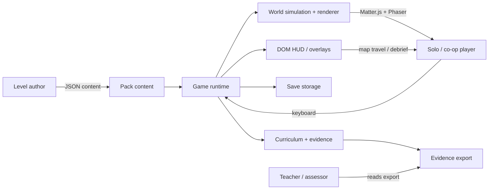
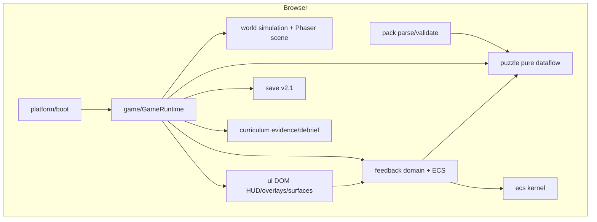
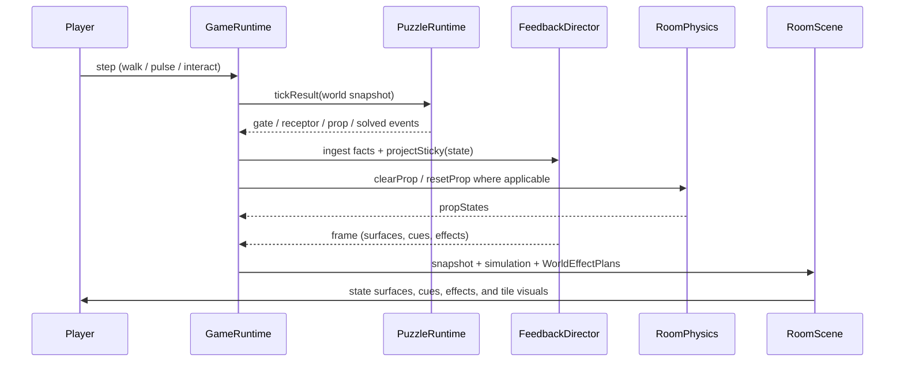
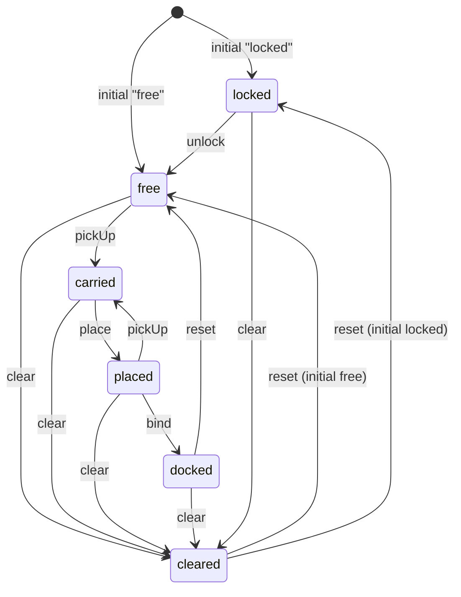
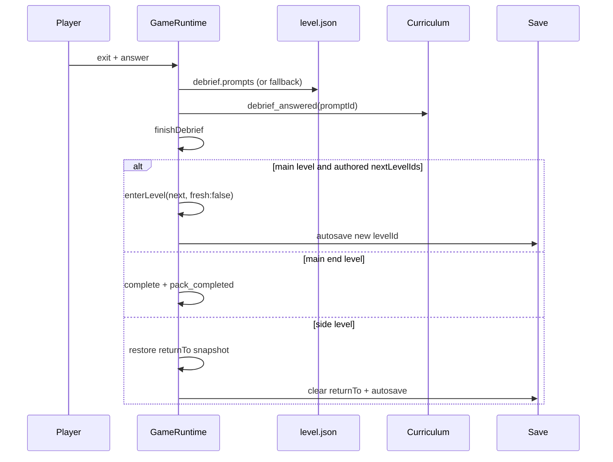
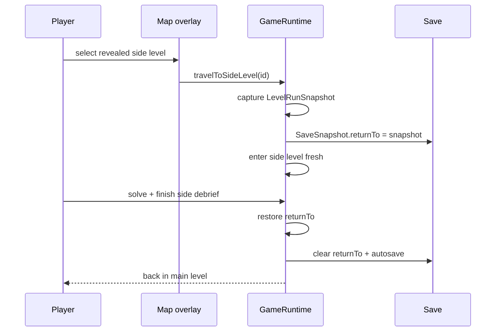
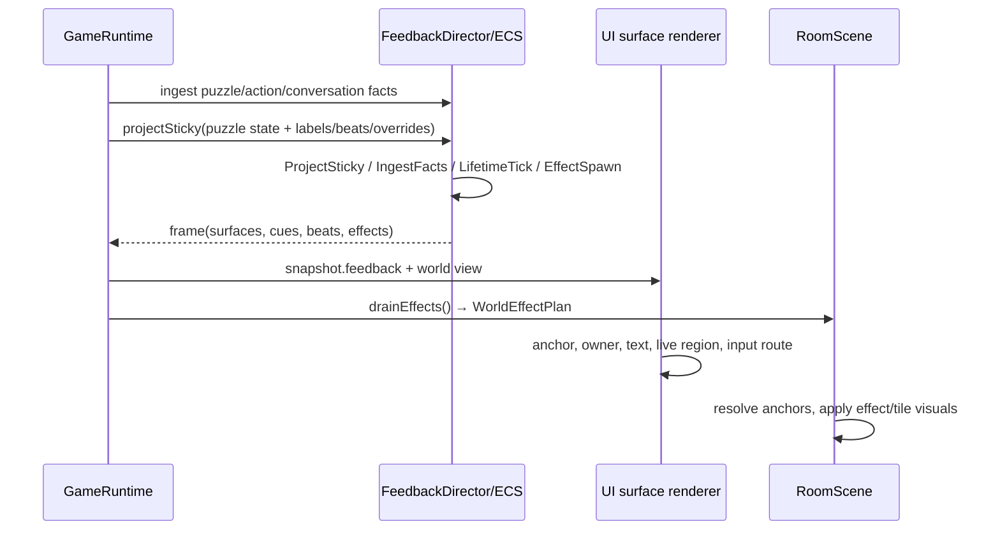
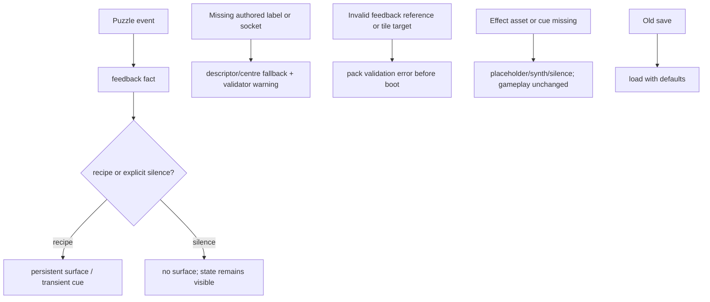
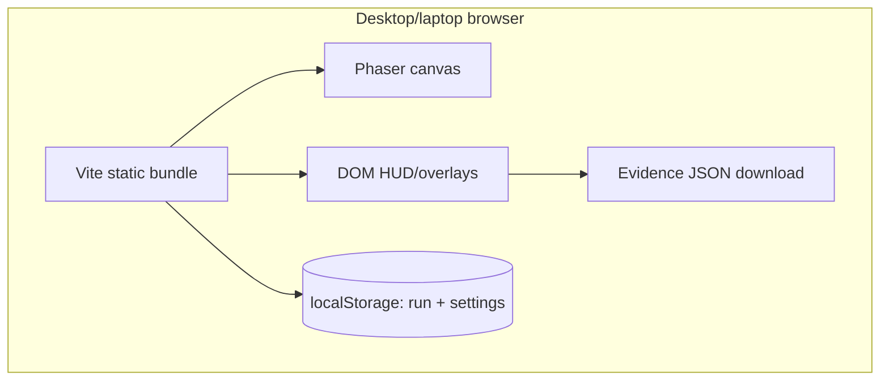

# Puzzle Engine Upgrade — Architecture (arc42)

**Status:** accepted design; M1.75 implementation complete, playtest pending
**Scope:** the engine capabilities needed by the intended M2 nervous-system
puzzle design (`03`–`05`, Silicon, optional `01`/`02`)
**Related:** [ADR log](adr/), [behavior contracts](behaviors/),
[precise contracts](contracts/), [traceability](traceability.md),
[implementation plan](implementation-plan.md), [M2 puzzle design](../m2/nervous-puzzles/README.md),
[ADR-0046 level transitions](../adr-m1.5/0046-level-transitions.md),
[M4 online co-op](../m4/README.md), [online ADR domain](../adr-online/README.md)

---

## 1. Introduction & Goals

### 1.1 Requirements overview

`puzzle-engine` is the upgrade layer that lets the accepted M2 puzzle design be
expressed in data rather than per-level engine code. The implemented M1.75 layer
adds the feedback ECS, capability-based persistent surfaces and cues, entity
conversations, co-op attribution, composable cosmetic effects, and tile visual
state. The earlier M1.5 target also specified physical gate bodies, a richer
prop lifecycle, conditional links, per-level debrief prompts, and side-level
map travel; the implementation status table below distinguishes what is
currently in the code from what remains an accepted target.

The upgrade is not a new game or a scripting engine. It is a set of optional
content capabilities plus the runtime/rendering seams that make them real.

### Implementation status (2026-10-28)

| Area | Status in this branch |
|---|---|
| Correctness gate and reachable-state recovery | Implemented |
| Generic ECS kernel and feedback domain | Implemented |
| Feedback surfaces, cues, anchors, co-op ownership, per-player input | Implemented |
| Entity conversations replacing the global dialogue overlay | Implemented |
| Composable effect plans, world effect ports, tile visual state | Implemented |
| Capability descriptor coverage and feedback validation | Implemented |
| Physical puzzle-gate bodies | Deferred; logical gate state is implemented |
| `locked` props and `unlock` links | Deferred |
| Conditional links (`requires`), authored `message`, `linkBlocked` | Deferred |
| Per-level debrief prompt overrides | Deferred; syllabus-derived fallback is implemented |
| Side-level map travel and `returnTo` | Deferred |
| `clear` links and `cleared` props | Implemented |

Accepted ADRs remain immutable. “Accepted” describes the decision, not the
implementation status; this table is the implementation authority for the
current branch.

### 1.2 Quality goals (top 5)

| # | Goal | Scenario (Gherkin-style) | Linked |
|---|---|---|---|
| Q1 | Faithful causal gate behavior | Given 04's Ca²⁺ gate is closed, when the player triggers the terminal, carries ACh, or pulses at the wrong time, then the persistent timer/gate/receptor surfaces and rejection cue explain the current state without changing the puzzle's logical outcome. Physical gate bodies remain deferred. | ADR-0002, ADR-0003, ADR-0009–0013; `feedback-surfaces.feature` |
| Q2 | No-softlock recovery | Given a cleared or docked prop, a puzzle state, or a checkpoint, when the player resets, saves, or restores, then the state is restored and the puzzle remains completable. Locked props and side-return snapshots remain deferred. | ADR-0004, ADR-0008; `prop-lifecycle.feature`, `schema-compatibility.feature` |
| Q3 | Data-only authorability | Given a puzzle author adds labels, beats, a named effect preset, a tile target, anchors, or sockets, when the pack validates, then the behavior is expressed in JSON with no level-specific code; invalid feedback references and tile targets are rejected with a code and message. | ADR-0008–0013; `capability-coverage.feature`, `cosmetic-effects.feature` |
| Q4 | Backward compatibility | Given an existing 1.0 puzzle, 1.0 level, or 2.0 save, when it is loaded by the upgraded runtime, then its old behavior is preserved and optional feedback/conversation fields default off. | ADR-0008, ADR-0011; `schema-compatibility.feature`, `entity-conversations.feature` |
| Q5 | Testability and observability | Given a surface, cue, effect, conversation, or tile visual change, when it is produced, then the pure feedback frame and simulation state expose it without Phaser/Matter, and the browser test can verify the rendered room, live region, and evidence export. | ADR-0001, ADR-0009–0013; all behavior contracts |

### 1.3 Stakeholders

| Stakeholder | Expectations |
|---|---|
| Level author / designer (Snorre) | Author intended puzzle beats in JSON; no per-level engine branches; clear validation errors. |
| Solo and co-op players | Cause and effect are visible; blocked actions give feedback; no lost props or unrecoverable states; keyboard-only play. |
| Developer / AI agent | Narrow public APIs, deterministic pure tests, explicit contracts, phased migration. |
| Teacher / assessor | Level-specific debrief evidence; no accidental evidence reuse across levels. |
| Future maintainer | Immutable ADRs, a traceability matrix, and no hidden cross-module dependencies. |

## 2. Constraints

| Constraint | Source |
|---|---|
| Keep compact modules, sealed by default; cross-module access only through public APIs | ADR-0001, repo boundary tests |
| Puzzle documents remain declarative dataflow; no scripts, callbacks, or arbitrary expressions | ADR-0034, ADR-0001 |
| `puzzle` stays pure and independent of Matter.js, Phaser, DOM, pack loading, and save I/O | existing module boundaries, ADR-0001 |
| Fixed 60 Hz simulation; Matter.js only in `world`; Phaser only in the world renderer | existing runtime, ADR-0005 |
| No new movement verbs or abilities | ADR-0009 (M1.5), M2 design |
| One active puzzle and one tether policy per room | ADR-0038, ADR-0042 |
| Feedback surfaces and conversations are the only new UI surfaces; map travel is deferred | ADR-0009–0011, ADR-0007 |
| Save v2 remains the run format; the optional `conversations` list is the new field (`returnTo` is deferred) | ADR-0041, ADR-0045, ADR-0008, ADR-0011 |
| Placeholder-first assets; no final art requirement | ADR-0029–0033 |
| Existing 03/04 content and 2.0 saves remain valid | ADR-0008 |
| Keyboard-only, reduced-motion-friendly, no mouse-only action | ADR-0018, ADR-0020 |
| Docs live outside the Obsidian vault | repo documentation rule |

## 3. Context & Scope

### 3.1 System context (C4 L1)

### 3.2 External interfaces

| Interface | Protocol | Notes |
|---|---|---|
| Pack content | JSON files + loader | `pack`, `level`, `room`, `dialogue`, `puzzle`, `syllabus`, `mapping` |
| Player input | keyboard events | fixed key map; no new verb |
| Run persistence | `localStorage` via `SaveStorage` | schema 2.1; settings separate |
| Evidence export | browser download / JSON | local only, no telemetry |
| Renderer | Phaser 4 + Matter.js 0.20 | confined to `world` |
| Tests | Vitest + Playwright | pure domain tests + browser smoke |

## 4. Solution Strategy

The upgrade has five defining moves:

1. **State stays in the puzzle graph.** Gate, prop, timer, counter, and
   condition state is owned by `PuzzleRuntime`. Feedback projects that state;
   the world renders props and cosmetic effects but does not become a second
   puzzle engine. Physical gate bodies and conditional links are deferred.
2. **Opt-in schema fields.** Feedback labels/beats/effect presets/tile targets,
   anchors, sockets, and conversation snapshots are optional. Old content and
   saves behave as before. This is the compatibility strategy in ADR-0008 and
   ADR-0011. Gate bodies, prop initial/unlock fields, conditional links, debrief
   overrides, and side-level kinds remain deferred targets.
3. **One synchronization point.** `GameRuntime` synchronizes implemented prop
   state (`clear`/reset/restore) and projects feedback after entry, restore,
   reset, and puzzle events. `RoomPhysics` exposes imperative operations;
   `RoomScene` reads simulation state. Gate-body and side-return synchronization
   are deferred.
4. **Feedback is state projection, not a new source of truth.** Persistent
   surfaces are rebuilt from puzzle/world state, transient cues are sequenced
   separately, and cosmetic effects never mutate state or collision. Entity
   conversations and co-op attribution use the same surface model. This is the
   strategy in ADR-0009, ADR-0010, ADR-0011, and ADR-0013.
5. **Travel is bounded (deferred).** The main path remains linear (ADR-0046).
   Optional 01/02 were specified as side excursions with a single `returnTo`
   snapshot, not a full per-level cache. Side travel and map travel controls are
   not implemented in this branch; the current debrief transitions directly to
   the next authored level.

## 5. Building Block View

### 5.1 Container view (C4 L2)

### 5.2 Component view (C4 L3)

Each component is a compact module. Its “Public API” is the only surface other
modules may depend on.

| Component | Responsibility | Public API | Hidden internals |
|---|---|---|---|
| `core` | result/logging/learning-event primitives | `Result`, `silentLogger`, `LearningEventType` | helpers, constants |
| `syllabus` | parse/lookup objectives, concepts, evidence | `parseSyllabus`, `objectiveById`, `conceptById`, `prerequisites` | validation tables |
| `assets` | logical asset resolution/preload | `createAssets`, `AssetsModule`, `AssetId`, `PreloadPlan`, `PLAYER_ASSET_IDS` | provider chain, caches |
| `puzzle` | pure typed dataflow; gate/prop/condition state | `PuzzleRuntime`, `validatePuzzleDocument`, `replaySolution`, document/state/event types | node maps, tick ordering, counters |
| `ecs` | generic deterministic entity/component/system kernel | `createEcsWorld`, `createEntityId`, `defineComponent`, world/component/system types | component stores, system ordering |
| `feedback` | capability descriptors, facts, director, surfaces, cues, effects | `createFeedbackDirector`, `projectSignal`, descriptors, effect presets, feedback types | ECS components, cue bookkeeping, projection |
| `pack` | parse/validate pack content and mapping | parse functions, `validatePack`, `buildMapping`, content types, injected `FeedbackValidationVocabulary` | file discovery, reference checks |
| `progression` | abilities/flags/gates/map graph | `createProgression`, `unlockAbility`, `setFlag`, `mapNodes`, `mapEdges`, `reachableLevels` | snapshot normalization |
| `narrative` | dialogue graph/session | `startDialogue`, `advanceDialogue`, `chooseDialogueOption`, `currentNode` | condition evaluation context |
| `curriculum` | evidence, debrief prompts, export | `createCurriculum`, `recordEvent`, `evidenceForObjective`, `debriefPrompts`, `exportEvidence` | event matching |
| `save` | run/settings persistence | `createSave`, `SaveModule`, `RunSnapshot`, `RUN_SCHEMA_VERSION`, conversation snapshots | storage parsing/migration |
| `audio` | cue/music playback | `createAudio`, `AudioModule` | synth/file providers |
| `ui` | DOM HUD/overlays/anchored feedback surfaces | `mountGameUi`, `RuntimeSnapshot` views, feedback renderer, callbacks | DOM nodes, focus, layout, live region |
| `world` | Matter.js simulation + Phaser scene + cosmetic effect ports | `createRoomSimulation`, `stepRoomSimulationWithCues`, `RoomSimulation`, `RoomPhysics`, `RoomScene`, `createGame`, effect/tile ports, `simplifyForReducedMotion` | bodies, constraints, sprites, camera, effect layers |
| `game` | orchestration: lifecycle, puzzles, feedback, conversations, save | `GameRuntime`, `RuntimeOptions`, `AudioPort`, surface router, effect mapper | private maps/sets, sync points |
| `platform` | browser boot + adapters | `bootGame` | DOM canvas, storage/audio wiring |

The full public API and dependency graph are in
[`contracts/module-boundaries.md`](contracts/module-boundaries.md). The M1.75
operations are concentrated in `ecs` (deterministic kernel), `feedback`
(surfaces, cues, descriptors, effects), `game` (facts, conversations, effect
mapping, routing), `ui` (surface rendering/layout), `world` (effect and tile
visual ports), `pack` (feedback validation), and `save` (conversation
snapshots). The earlier M1.5 gate-body, conditional-link, debrief-override, and
side-travel operations remain deferred as recorded above.

### 5.3 Code level (C4 L4)

The implemented seams are:

- `PuzzleRuntime` ↔ `GameRuntime` via `nodeState`, `tickResult`, `reset`,
  `restore`, `snapshot`.
- `GameRuntime` ↔ `FeedbackDirector` via facts, `projectSticky`, `putSurface`,
  `removeSurface`, `tick`, and `frame`.
- `GameRuntime` ↔ `RoomPhysics` via prop operations (`clearProp`, `resetProp`,
  `propStates`); gate-body synchronization remains deferred.
- `GameRuntime` ↔ `Curriculum` via `debriefPromptList`/`debriefPrompts`;
  per-level override plumbing remains deferred.
- `GameRuntime` ↔ `UI` via `RuntimeSnapshot`, surface actions, and the renderer
  contract.
- `GameRuntime` ↔ `Save` via `RunSnapshot`/`RunLoadResult` and conversation
  snapshots.
- `GameRuntime` ↔ `RoomScene` via the resolved `WorldEffectPlan`/tile ports and
  `drainEffects`.
- `platform` ↔ `RoomScene` via `onLevelChange` and scene restart (ADR-0046).

## 6. Runtime View

### 6.1 Puzzle evaluation and feedback projection

Order is deliberately single-writer: the puzzle graph evaluates first, the
orchestrator applies world changes, feedback projects the resulting facts and
state, and the scene renders the frame. Feedback and effects never write puzzle,
physics, or collision state. Conditional links and physical gate bodies remain
deferred.

### 6.2 Prop lifecycle

The implemented lifecycle is `free → carried → placed → docked` plus `clear →
cleared` and reset. `locked` and `unlock` remain accepted but deferred; the
diagram below includes them as target transitions.

The `locked → free` unlock transition is deferred. A `clear` link is the only
implemented transition to `cleared`. Reset is the recovery path and restores the
authored state.

### 6.3 Per-level debrief and main transition

The runtime currently derives every debrief prompt from the syllabus and
transitions directly to the next authored level. Per-level prompt overrides and
side-return branching remain deferred; the sequence below is the target shape.

### 6.4 Side-level excursion (deferred)

### 6.5 Feedback, effects, and conversations

Persistent surfaces are rebuilt from state on every projection. Cues are
deduplicated by cause and expire by TTL. Effects are cosmetic: they cannot
change puzzle, world, or collision state. Reduced motion simplifies movement
into static markers while preserving the surface text and persistent state.

### 6.6 Failure / degradation path

The upgrade has no fail state. Missing optional feedback, effect assets, or
audio degrade gracefully; invalid authored references fail validation before
boot. Feedback never removes evidence or creates a dead run.

## 7. Deployment View

Single-user, local-only deployment is the default; no backend or network
telemetry is required for local play. The engine upgrade does not change that
default. Tests run in Node (Vitest) and system Chrome (Playwright).

**Optional online co-op amendment.** M4 adds a host-authoritative, two-player
online mode. The host browser remains the single writer of game state; the guest
is a thin renderer and input source. A Cloudflare Durable Object relays
WebSockets and stores no game state. Local single-player and local co-op remain
unchanged and do not require the Worker. See
[`../adr-online/README.md`](../adr-online/README.md) and
[`../m4/README.md`](../m4/README.md).

## 8. Cross-cutting Concepts

| Concept | Approach |
|---|---|
| Module sealing / public APIs | ADR-0001; [`contracts/module-boundaries.md`](contracts/module-boundaries.md) |
| Gate and prop state ownership | Puzzle graph owns logical state; world owns bodies; `GameRuntime` is the single synchronizer |
| Schema evolution | Optional fields + minor versions; old content/saves default off (ADR-0008) |
| Feedback | State-projected persistent surfaces plus sequenced, deduplicated transient cues; capability descriptors; co-op attribution; entity conversations; cosmetic effect plans (ADR-0009–0013) |
| No-fail recovery | Reset, checkpoint, and save/restore restore valid state; blocked actions never consume evidence. Side return is deferred. |
| Presentation as projection | Puzzle state drives sticky feedback surfaces; `RoomSimulation` prop state and `WorldEffectPlan` drive `RoomScene`; `world` imports no feedback. |
| Accessibility | Keyboard-only play, focus management, owner-aware soft surfaces, persistent text/state alternatives, and a live region with actor attribution; reduced motion simplifies or removes effects without losing information (ADR-0013). |
| Determinism | Fixed-step puzzle evaluation; no wall-clock or random behavior in `puzzle` |

## 9. Architectural Decisions

| # | Decision | Status |
|---|---|---|
| [0001](adr/0001-compact-modules-public-apis.md) | Keep compact modules and public APIs as the base model | Accepted |
| [0002](adr/0002-physical-puzzle-gates.md) | Physical puzzle gates from authored gate state | Accepted |
| [0003](adr/0003-gate-prop-presentation.md) | Gate and prop presentation state | Accepted |
| [0004](adr/0004-prop-lifecycle-actions.md) | Prop lifecycle states and unlock/clear actions | Accepted |
| [0005](adr/0005-conditional-links-feedback.md) | Conditional links and blocked-link feedback | Accepted |
| [0006](adr/0006-per-level-debrief-prompts.md) | Per-level debrief prompts with syllabus fallback | Accepted |
| [0007](adr/0007-side-level-map-travel.md) | Side-level map travel with a return snapshot | Accepted |
| [0008](adr/0008-schema-evolution.md) | Backward-compatible schema evolution | Accepted |
| [0009](adr/0009-feedback-ecs-substrate.md) | Feedback ECS as the generic ECS substrate | Accepted |
| [0010](adr/0010-anchored-feedback-surfaces.md) | Anchored feedback surfaces, co-op ownership, and input routing | Accepted |
| [0011](adr/0011-entity-conversations.md) | Entity conversations replace the global dialogue overlay | Accepted |
| [0012](adr/0012-capability-feedback-coverage.md) | Capability-based feedback defaults and coverage | Accepted |
| [0013](adr/0013-cosmetic-feedback-effects-accessibility.md) | Cosmetic feedback effects, composable effect plans, and accessibility | Accepted |

Proposed material and pattern architecture (not yet accepted; see the ADR log):

| # | Decision | Status |
|---|---|---|
| [0014](adr/0014-material-pattern-vocabulary.md) | Material and pattern vocabulary | Proposed |
| [0015](adr/0015-tile-material-grid-autotiling.md) | Tile material grid, autotiling, and variants | Proposed |
| [0016](adr/0016-pattern-projection-surfaces.md) | Pattern projection across tiles, objects, backgrounds, and UI | Proposed |
| [0017](adr/0017-tile-variant-atlas-manifest.md) | Tile variant atlas and manifest metadata | Proposed |

ADR-0009 and ADR-0010 supersede the old "feedback is a toast / no new UI
surface" constraints in §2, §4 (strategy item 4), and §8. ADR-0013 amends
ADR-0003's no-animation constraint; ADR-0011 adds the optional conversation save
field. Acceptance is not implementation: see the status table above for the
deferred M1.5 capabilities.

Implementation: [`feedback-implementation-plan.md`](feedback-implementation-plan.md)
and the [M1.75 milestone](../m1.75/README.md).

The material/pattern layer is planned separately in
[`material-pattern-implementation-plan.md`](material-pattern-implementation-plan.md)
and the [M1.8 milestone](../m1.8/README.md).

Existing decisions remain in force: ADR-0034 (dataflow), ADR-0035 (body +
prop), ADR-0036 (Matter boundary), ADR-0037 (solo union), ADR-0038 (tether),
ADR-0039 (puzzle as assessment), ADR-0040 (prop softlock contract), ADR-0041
(save v2), ADR-0042 (activation), ADR-0043 (hints/cooldown), ADR-0044
(hazards/checkpoints), ADR-0045 (version mismatch), ADR-0046 (level
transitions).

## 10. Quality Requirements

### 10.1 Quality tree

```mermaid
flowchart TD
    Q[Puzzle-engine quality] --> C[Causal fidelity]
    Q --> R[Recoverability]
    Q --> A[Authorability]
    Q --> B[Backward compatibility]
    Q --> T[Testability]
    Q --> F[Feedback legibility]
    Q --> O[Co-op attribution]
    Q --> X[Accessibility]
    C --> C1[Puzzle state is truthful]
    C --> C2[Feedback projects state]
    R --> R1[Reset/restore props, puzzles, checkpoints]
    R --> R2[Old saves load]
    A --> A1[JSON-only feedback content]
    A --> A2[Validator diagnostics]
    B --> B1[Old content loads]
    B --> B2[Old saves load]
    T --> T1[Pure feedback frames]
    T --> T2[Headless + browser tests]
    F --> F1[Persistent state + transient cues]
    F --> F2[Capability descriptors]
    O --> O1[Actor/owner/accent]
    O --> O2[Per-player input ownership]
    X --> X1[Text alternatives]
    X --> X2[Reduced motion]
```

### 10.2 Quality scenarios

| # | Scenario | Behavior contract |
|---|---|---|
| Q1 | Persistent timer/gate/receptor state and rejection cues explain the current puzzle state without changing it | `feedback-surfaces.feature` |
| Q2 | Reset/save/restore preserve the implemented puzzle/prop/checkpoint state; side return is deferred | `prop-lifecycle.feature`, `schema-compatibility.feature` |
| Q3 | Authors add labels, beats, effect presets, tile targets, anchors, and sockets; validation rejects invalid references | `capability-coverage.feature`, `cosmetic-effects.feature` |
| Q4 | 1.0 level/puzzle and 2.0 saves load with old behavior; feedback joins the save only through conversations | `schema-compatibility.feature`, `entity-conversations.feature` |
| Q5 | Pure feedback frames and simulation expose transitions; browser proves canvas, live region, and evidence | all behavior contracts |
| Q6 | A state change produces a persistent surface and a cause produces an attributed transient cue | `feedback-surfaces.feature` |
| Q7 | P1 and P2 surfaces/effects remain separately owned and attributed | `feedback-surfaces.feature` |
| Q8 | Two entity conversations can be active while the other player keeps moving | `entity-conversations.feature` |
| Q9 | A new node type requires one descriptor; every event is cued or explicitly silent | `capability-coverage.feature` |
| Q10 | Effects never mutate state or collision; reduced motion preserves text and state | `cosmetic-effects.feature` |

### 10.2b Functional behavior contracts

| Feature file | Concern | Source ADRs | Status |
|---|---|---|---|
| `behaviors/feedback-surfaces.feature` | Persistent state, transient cues, ownership, anchors, input | 0009, 0010, 0012 | Implemented |
| `behaviors/entity-conversations.feature` | Concurrent conversations, save/restore, recovery | 0011 | Implemented |
| `behaviors/capability-coverage.feature` | Descriptor coverage, rejection reasons, event coverage | 0012 | Implemented |
| `behaviors/cosmetic-effects.feature` | Direction/path/follow/cancel, tile visuals, reduced motion | 0013 | Implemented |
| `behaviors/physical-gates.feature` | Gate bodies, latch, opt-in, reset/restore | 0002 | Deferred (logical gates implemented) |
| `behaviors/gate-presentation.feature` | Open/closed sprites, fallback, cleared props | 0003 | Partial; feedback surfaces implemented |
| `behaviors/prop-lifecycle.feature` | locked/free/unlock/clear/reset/save | 0004 | Partial; clear/cleared implemented |
| `behaviors/causal-links.feature` | requires, blocked feedback, pulse/cooldown | 0005 | Deferred |
| `behaviors/per-level-debrief.feature` | override, fallback, evidence, missing answer | 0006 | Partial; syllabus fallback implemented |
| `behaviors/map-travel.feature` | side entry, return snapshot, save/restore, invalid travel | 0007 | Deferred |
| `behaviors/schema-compatibility.feature` | old/new puzzle, level, save; invalid new fields | 0008 | Implemented |

### 10.3 Definition of done (documentation)

The documentation set is complete when:

- No unresolved authoring markers remain anywhere.
- Every ADR appears in the §9 index, and ADR-0001 affirms the base model.
- Every module has a documented public API in `contracts/module-boundaries.md`.
- Every §10.2 quality scenario links a Gherkin behavior contract in
  `traceability.md`.
- Cross-cutting mechanisms have a precise contract in `contracts/`.
- The traceability matrix maps every ADR to arc42 sections, behavior, contract,
  and quality scenario.

## 11. Risks & Technical Debt

| # | Risk | Severity | Mitigation |
|---|---|---|---|
| R1 | Gate body closes on a player/carried prop and causes a physics shove | Medium | Author close-behind layouts; test overlap; no teleport/fail |
| R2 | Prop state expansion breaks old saves | Medium | ADR-0008 compatibility fixtures; parser defaults |
| R3 | Conditional links hide ordering mistakes until runtime | Medium | Deferred. When implemented: validator checks `requires`, authored messages, and behavior tests. |
| R4 | Side return snapshot misses a field and loses main-level state | High | Deferred. When implemented: one `LevelRunSnapshot` type, round-trip tests, e2e side excursion. |
| R5 | Prompt IDs and evidence rules drift | Medium | Current debrief prompts derive from the syllabus. When overrides are implemented: validator checks override/evidence match and mapping tests. |
| R6 | Two sync points fight over gate/prop state | Medium | Single `GameRuntime` sync point; no scene writes; tests |
| R7 | Map travel UI is mouse-only or focus-trapped | Medium | Keyboard-focusable controls; focus test; reduced motion |
| R8 | Scope creep into full backtracking/cache | Medium | ADR-0007 limit; no per-level cache; plan phases |

## 12. Glossary

| Term | Definition |
|---|---|
| Feedback surface | A persistent, state-projected UI element owned by a player or shared; rebuilt from puzzle/world state. |
| Feedback cue | A transient, sequenced response to a fact; deduplicated by cause and expired by TTL. |
| Capability descriptor | The code table mapping a puzzle node/link type to feedback capabilities, projection, cues, and default effects. |
| Effect plan | A cosmetic composition of closed visual operators, paths, timing, binding, and cancellation; never gameplay state. |
| Conversation surface | A `speechBubble` surface owned by the interacting player and anchored to an entity. |
| Tile visual | A temporary appearance override on a tile or region; never collision. |
| Gate body | A static Matter.js solid attached to a `puzzleGate` entity and toggled by puzzle gate state. **Deferred.** |
| Conditional link | A puzzle link with `requires`; it applies only when the referenced node is active. **Deferred.** |
| `linkBlocked` | Puzzle event emitted when a conditional link's condition is false; it carries authored feedback. **Deferred.** |
| Locked prop | A visible, static, non-pickable prop that can be released by an `unlock` link. **Deferred.** |
| Cleared prop | A hidden, non-collidable prop removed by a `clear` link; reset restores its initial state. Implemented. |
| Level override | A level-authored debrief prompt array replacing the syllabus-derived prompt. **Deferred.** |
| Side excursion | A `kind: "side"` level entered from the map and returned from via `returnTo`. **Deferred.** |
| Return snapshot | `RunSnapshot.returnTo`, the level-scoped state captured before a side excursion. **Deferred.** |
| Main level | A level on the linear ADR-0046 path. |
| Base model | Compact modules sealed by default with explicit public APIs. |

---

## Appendix A: Standards mapping (ISO/IEC/IEEE 42010 + SEI Views & Beyond)

| 42010 concept | Where |
|---|---|
| Concerns | §1.2 quality goals, §10.1 tree |
| Viewpoints | Appendix B |
| Views | §5 structure, §6 runtime, §7 deployment |
| Architecture decisions | §9 + ADR log |
| Rationale | ADR Context/Consequences |
| Correspondences | Appendix B mapping table |

| SEI viewtype | Style | This system |
|---|---|---|
| Module | layered, decomposition | §5.2 components; module boundaries |
| Component-and-connector | communicating processes / shared state | §6 sequences and state diagrams |
| Allocation | deployment | §7 browser/localStorage |

## Appendix B: Viewpoint declaration

| Viewpoint | Audience | Concern | Section |
|---|---|---|---|
| Context | everyone | scope, external interfaces | §3 |
| Container | architects | runtime/technology boundaries | §5.1 |
| Component | developers | responsibilities, public APIs | §5.2 |
| Runtime | developers/testers | puzzle, feedback, conversation, and effect flows | §6 |
| Deployment | platform engineers | browser/storage constraints | §7 |
| Decision | maintainers | why | §9, ADR log |
| Behavior contracts | testers/agents | executable rules | `behaviors/` |
