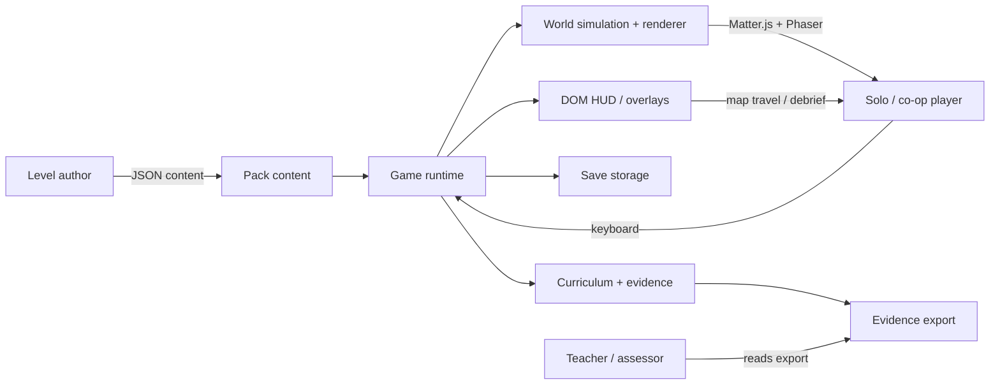
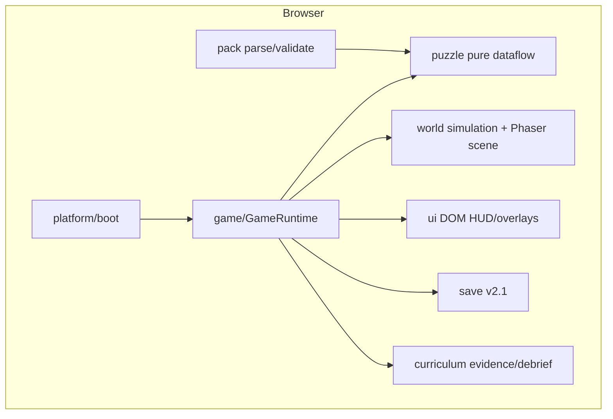
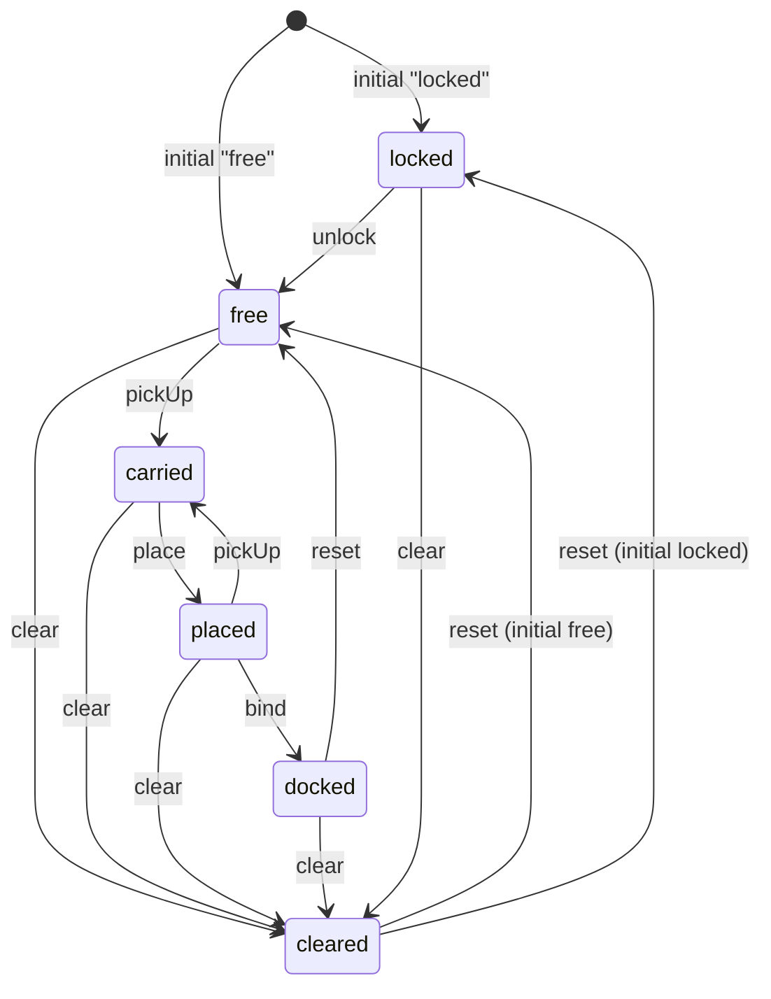
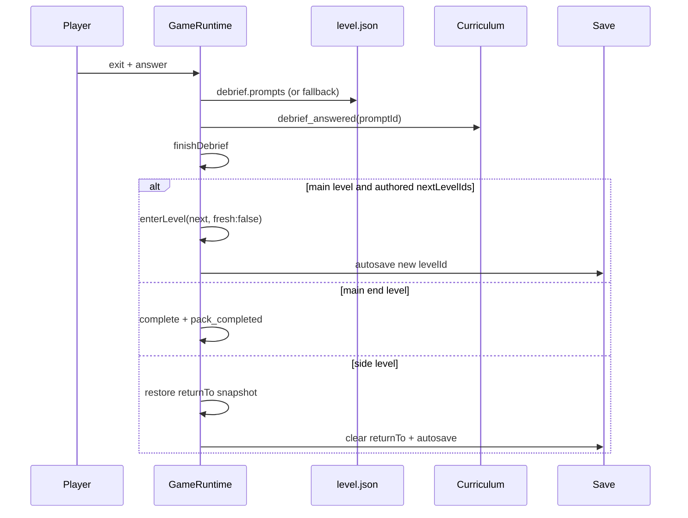
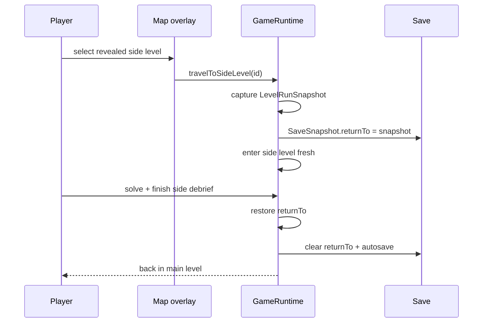
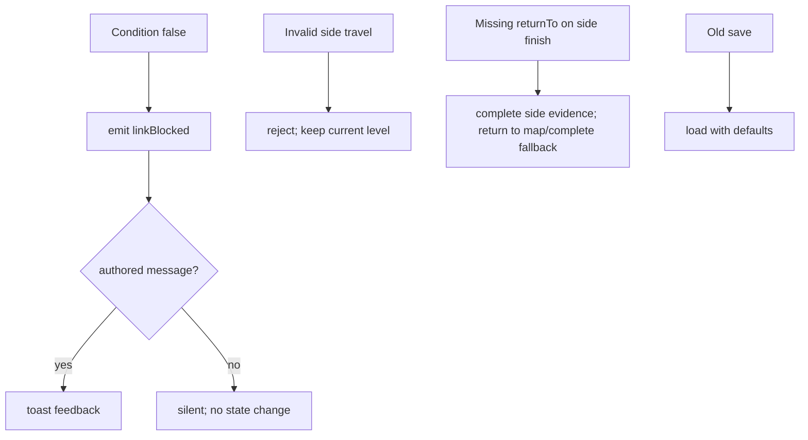
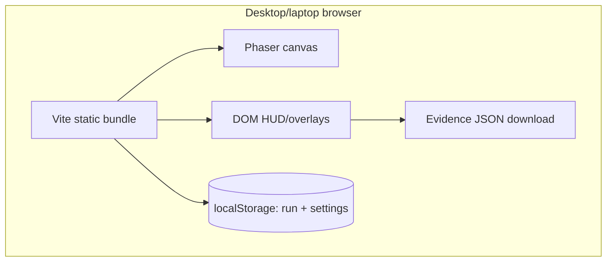
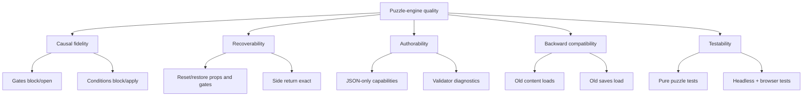

# Puzzle Engine Upgrade — Architecture (arc42)

**Status:** accepted design, implementation not started
**Scope:** the engine capabilities needed by the intended M2 nervous-system
puzzle design (`03`–`05`, Silicon, optional `01`/`02`)
**Related:** [ADR log](adr/), [behavior contracts](behaviors/),
[precise contracts](contracts/), [traceability](traceability.md),
[implementation plan](implementation-plan.md), [M2 puzzle design](../m2/nervous-puzzles/README.md),
[ADR-0046 level transitions](../adr-m1.5/0046-level-transitions.md)

---

## 1. Introduction & Goals

### 1.1 Requirements overview

`puzzle-engine` is the upgrade layer that lets the accepted M2 puzzle design be
expressed in data rather than per-level engine code. It adds physical gates,
gate/prop presentation state, a richer prop lifecycle, conditional links with
blocked-link feedback, per-level debrief prompts, and side-level map travel.
It keeps the existing compact-module model, the declarative puzzle dataflow, the
fixed-step simulation, and the v2 save model.

The upgrade is not a new game or a scripting engine. It is a set of optional
content capabilities plus the runtime/rendering seams that make them real.

### 1.2 Quality goals (top 5)

| # | Goal | Scenario (Gherkin-style) | Linked |
|---|---|---|---|
| Q1 | Faithful causal gate behavior | Given 04's Ca²⁺ gate is closed with a body, when the player walks into it, then movement is blocked; when the gate opens, the player passes. Given the pulse link requires the Ca²⁺ gate, when the player pulses early, then the receptor does not bind and the authored “not released yet” message appears. | ADR-0002, ADR-0005; ADR-0003; `physical-gates.feature`, `causal-links.feature` |
| Q2 | No-softlock recovery | Given a locked, cleared, or docked prop, when the player resets, saves, restores, or returns from a side level, then the prop, gate, timer, and checkpoint state are restored exactly and the puzzle remains completable. | ADR-0002, ADR-0004, ADR-0007; `prop-lifecycle.feature`, `map-travel.feature` |
| Q3 | Data-only authorability | Given a puzzle author adds a gate body, prop initial state, unlock/clear link, `requires` condition, debrief override, or side-level map edge, when the pack validates, then the behavior is expressed in JSON with no level-specific code; invalid combinations are rejected with a code and message. | ADR-0002–0008; `schema-compatibility.feature` |
| Q4 | Backward compatibility | Given an existing 1.0 puzzle, 1.0 level, or 2.0 save, when it is loaded by the upgraded runtime, then its old behavior is preserved and new fields default off. | ADR-0008; `schema-compatibility.feature` |
| Q5 | Testability and observability | Given a gate, prop, condition, prompt, or travel transition, when it changes, then the pure puzzle state and the simulation state expose the change without Phaser/Matter, and the browser test can verify the rendered room and evidence export. | ADR-0001, ADR-0003; all behavior contracts |

### 1.3 Stakeholders

| Stakeholder | Expectations |
|---|---|
| Level author / designer (Snorre) | Author intended puzzle beats in JSON; no per-level engine branches; clear validation errors. |
| Solo and co-op players | Cause and effect are visible; blocked actions give feedback; no lost props or unrecoverable states; keyboard-only play. |
| Developer / AI agent | Narrow public APIs, deterministic pure tests, explicit contracts, phased migration. |
| Teacher / assessor | Level-specific debrief evidence; no accidental evidence reuse across levels. |
| Future maintainer | Immutable ADRs, a traceability matrix, and no hidden cross-module dependencies. |

## 2. Constraints

| Constraint | Source |
|---|---|
| Keep compact modules, sealed by default; cross-module access only through public APIs | ADR-0001, repo boundary tests |
| Puzzle documents remain declarative dataflow; no scripts, callbacks, or arbitrary expressions | ADR-0034, ADR-0001 |
| `puzzle` stays pure and independent of Matter.js, Phaser, DOM, pack loading, and save I/O | existing module boundaries, ADR-0001 |
| Fixed 60 Hz simulation; Matter.js only in `world`; Phaser only in the world renderer | existing runtime, ADR-0005 |
| No new movement verbs or abilities | ADR-0009, M2 design |
| One active puzzle and one tether policy per room | ADR-0038, ADR-0042 |
| No new UI surface except the map travel controls required by ADR-0007 | ADR-0043, ADR-0007 |
| Save v2 remains the run format; no new field except `returnTo` | ADR-0041, ADR-0045, ADR-0008 |
| Placeholder-first assets; no final art requirement | ADR-0029–0033 |
| Existing 03/04 content and 2.0 saves remain valid | ADR-0008 |
| Keyboard-only, reduced-motion-friendly, no mouse-only action | ADR-0018, ADR-0020 |
| Docs live outside the Obsidian vault | repo documentation rule |

## 3. Context & Scope

### 3.1 System context (C4 L1)



### 3.2 External interfaces

| Interface | Protocol | Notes |
|---|---|---|
| Pack content | JSON files + loader | `pack`, `level`, `room`, `dialogue`, `puzzle`, `syllabus`, `mapping` |
| Player input | keyboard events | fixed key map; no new verb |
| Run persistence | `localStorage` via `SaveStorage` | schema 2.1; settings separate |
| Evidence export | browser download / JSON | local only, no telemetry |
| Renderer | Phaser 4 + Matter.js 0.20 | confined to `world` |
| Tests | Vitest + Playwright | pure domain tests + browser smoke |

## 4. Solution Strategy

The upgrade has five defining moves:

1. **State stays in the puzzle graph.** Physical gate, prop, timer, and
   conditional-link state is owned by `PuzzleRuntime`. The world derives bodies
   and sprites from that state; it does not become a second puzzle engine.
2. **Opt-in schema fields.** Gate bodies, gate sprites, prop initial states,
   unlock/clear links, conditional conditions, debrief overrides, and side-level
   kinds are optional. Old content behaves as before. This is the compatibility
   strategy in ADR-0008.
3. **One synchronization point.** `GameRuntime` synchronizes world gate bodies
   and prop states after level entry, restore, reset, puzzle events, and side
   return. `RoomPhysics` exposes imperative operations; `RoomScene` reads
   simulation state.
4. **Feedback is data, not a new UI.** A blocked conditional link carries an
   authored message and uses the existing toast. It is not evidence and does
   not create a fail state.
5. **Travel is bounded.** The main path remains linear (ADR-0046). Optional
   01/02 are side excursions with a single `returnTo` snapshot, not a full
   per-level cache. The map becomes a keyboard-focusable travel surface only
   for eligible side levels.

## 5. Building Block View

### 5.1 Container view (C4 L2)



### 5.2 Component view (C4 L3)

Each component is a compact module. Its “Public API” is the only surface other
modules may depend on.

| Component | Responsibility | Public API | Hidden internals |
|---|---|---|---|
| `core` | result/logging/learning-event primitives | `Result`, `silentLogger`, `LearningEventType` | helpers, constants |
| `syllabus` | parse/lookup objectives, concepts, evidence | `parseSyllabus`, `objectiveById`, `conceptById`, `prerequisites` | validation tables |
| `assets` | logical asset resolution/preload | `createAssets`, `AssetsModule`, `AssetId`, `PreloadPlan`, `PLAYER_ASSET_IDS` | provider chain, caches |
| `puzzle` | pure typed dataflow; gate/prop/condition state | `PuzzleRuntime`, `validatePuzzleDocument`, `replaySolution`, document/state/event types | node maps, tick ordering, counters |
| `pack` | parse/validate pack content and mapping | parse functions, `validatePack`, `buildMapping`, content types | file discovery, reference checks |
| `progression` | abilities/flags/gates/map graph | `createProgression`, `unlockAbility`, `setFlag`, `mapNodes`, `mapEdges`, `reachableLevels` | snapshot normalization |
| `narrative` | dialogue graph/session | `startDialogue`, `advanceDialogue`, `chooseDialogueOption`, `currentNode` | condition evaluation context |
| `curriculum` | evidence, debrief prompts, export | `createCurriculum`, `recordEvent`, `evidenceForObjective`, `debriefPrompts`, `exportEvidence` | event matching |
| `save` | run/settings persistence | `createSave`, `SaveModule`, `RunSnapshot`, `RUN_SCHEMA_VERSION` | storage parsing/migration |
| `audio` | cue/music playback | `createAudio`, `AudioModule` | synth/file providers |
| `ui` | DOM HUD/overlays/map travel | `mountGameUi`, `RuntimeSnapshot` views, callbacks | DOM nodes, focus, rendering |
| `world` | Matter.js simulation + Phaser scene | `createRoomSimulation`, `stepRoomSimulationWithCues`, `RoomSimulation`, `RoomPhysics`, `RoomScene`, `createGame` | bodies, constraints, sprites, camera |
| `game` | orchestration: lifecycle, puzzles, save, prompts, travel | `GameRuntime`, `RuntimeOptions`, `AudioPort` | private maps/sets, sync points |
| `platform` | browser boot + adapters | `bootGame` | DOM canvas, storage/audio wiring |

The full public API and dependency graph are in
[`contracts/module-boundaries.md`](contracts/module-boundaries.md). The new
operations are concentrated in `puzzle` (state/events), `world` (gate/prop
bodies and presentation), `game` (sync/feedback/travel), `pack` (schema),
`save` (`returnTo`), `curriculum` (prompt overrides), and `ui` (map travel).

### 5.3 Code level (C4 L4)

Deferred to implementation. The pre-defined seams are:

- `PuzzleRuntime` ↔ `GameRuntime` via `nodeState`, `tickResult`, `reset`,
  `restore`, `snapshot`.
- `GameRuntime` ↔ `RoomPhysics` via `setGateOpen`, `setPropState`,
  `releaseProp`, `clearProp`, `resetProp`.
- `GameRuntime` ↔ `Curriculum` via `debriefPromptList`/`debriefPrompts`.
- `GameRuntime` ↔ `UI` via `RuntimeSnapshot` and callbacks.
- `GameRuntime` ↔ `Save` via `RunSnapshot`/`RunLoadResult`.
- `platform` ↔ `RoomScene` via `onLevelChange` and scene restart (ADR-0046).

## 6. Runtime View

### 6.1 Physical gates and causal links

```mermaid
sequenceDiagram
    participant Player
    participant Game as GameRuntime
    participant Puzzle as PuzzleRuntime
    participant World as RoomPhysics
    participant Scene as RoomScene
    Player->>Game: step (walk / pulse)
    Game->>Puzzle: tickResult(world snapshot)
    Puzzle-->>Game: gateOpen / linkBlocked / prop events
    Game->>World: setGateOpen / setPropState / unlock / clear
    World-->>Game: gateStates / propStates
    Game->>Scene: snapshot + simulation
    Scene->>Player: closed gate blocks; open gate passes; toast message
```

Order is deliberately single-writer: the puzzle graph evaluates first, the
orchestrator applies world changes, and the scene projects the resulting
simulation. A blocked conditional link never mutates the target.

### 6.2 Prop lifecycle



An unlock link is the only transition from `locked` to `free`; a clear link is
the only transition to `cleared`. Reset is the recovery path and restores the
authored initial state.

### 6.3 Per-level debrief and main transition



### 6.4 Side-level excursion



### 6.5 Failure / degradation path



The upgrade has no fail state. Blocked links, invalid travel, and missing
content produce feedback or graceful degradation, never evidence loss or a
dead run.

## 7. Deployment View



Single-user, local-only deployment; no backend or network telemetry. The
engine upgrade does not change deployment. Tests run in Node (Vitest) and
system Chrome (Playwright).

## 8. Cross-cutting Concepts

| Concept | Approach |
|---|---|
| Module sealing / public APIs | ADR-0001; [`contracts/module-boundaries.md`](contracts/module-boundaries.md) |
| Gate and prop state ownership | Puzzle graph owns logical state; world owns bodies; `GameRuntime` is the single synchronizer |
| Schema evolution | Optional fields + minor versions; old content/saves default off (ADR-0008) |
| Feedback | Authored conditional-link messages use the existing toast; no new panel or evidence type |
| No-fail recovery | Reset, checkpoint, side return, and save/restore restore valid state; blocked actions never consume evidence |
| Presentation as projection | `RoomSimulation.gateStates`/prop states drive `RoomScene`; no puzzle imports in `world` |
| Accessibility | Keyboard-only map travel, focus management, immediate state swaps under reduced motion |
| Determinism | Fixed-step puzzle evaluation; no wall-clock or random behavior in `puzzle` |

## 9. Architectural Decisions

| # | Decision | Status |
|---|---|---|
| [0001](adr/0001-compact-modules-public-apis.md) | Keep compact modules and public APIs as the base model | Accepted |
| [0002](adr/0002-physical-puzzle-gates.md) | Physical puzzle gates from authored gate state | Accepted |
| [0003](adr/0003-gate-prop-presentation.md) | Gate and prop presentation state | Accepted |
| [0004](adr/0004-prop-lifecycle-actions.md) | Prop lifecycle states and unlock/clear actions | Accepted |
| [0005](adr/0005-conditional-links-feedback.md) | Conditional links and blocked-link feedback | Accepted |
| [0006](adr/0006-per-level-debrief-prompts.md) | Per-level debrief prompts with syllabus fallback | Accepted |
| [0007](adr/0007-side-level-map-travel.md) | Side-level map travel with a return snapshot | Accepted |
| [0008](adr/0008-schema-evolution.md) | Backward-compatible schema evolution | Accepted |

Proposed feedback architecture (not yet accepted; see the ADR log):

| # | Decision | Status |
|---|---|---|
| [0009](adr/0009-feedback-ecs-substrate.md) | Feedback ECS as the generic ECS substrate | Proposed |
| [0010](adr/0010-anchored-feedback-surfaces.md) | Anchored feedback surfaces, co-op ownership, and input routing | Proposed |
| [0011](adr/0011-entity-conversations.md) | Entity conversations replace the global dialogue overlay | Proposed |
| [0012](adr/0012-capability-feedback-coverage.md) | Capability-based feedback defaults and coverage | Proposed |
| [0013](adr/0013-cosmetic-feedback-effects-accessibility.md) | Cosmetic feedback effects and accessibility | Proposed |

When accepted, ADR-0009 and ADR-0010 replace the "feedback is a toast / no new UI
surface" constraints in §4.4 and §8, and ADR-0013 amends ADR-0003's no-animation
constraint.

Existing decisions remain in force: ADR-0034 (dataflow), ADR-0035 (body +
prop), ADR-0036 (Matter boundary), ADR-0037 (solo union), ADR-0038 (tether),
ADR-0039 (puzzle as assessment), ADR-0040 (prop softlock contract), ADR-0041
(save v2), ADR-0042 (activation), ADR-0043 (hints/cooldown), ADR-0044
(hazards/checkpoints), ADR-0045 (version mismatch), ADR-0046 (level
transitions).

## 10. Quality Requirements

### 10.1 Quality tree



### 10.2 Quality scenarios

| # | Scenario | Behavior contract |
|---|---|---|
| Q1 | Closed gate body blocks; open gate passes; early pulse is blocked with authored feedback | `physical-gates.feature`, `causal-links.feature` |
| Q2 | Reset/save/restore/side return preserve locked/cleared props, gates, timers, checkpoint | `prop-lifecycle.feature`, `map-travel.feature` |
| Q3 | Author adds new fields; validator accepts valid and rejects invalid; no engine code | `schema-compatibility.feature` |
| Q4 | 1.0/2.0 content and saves load with old behavior | `schema-compatibility.feature` |
| Q5 | Pure runtime and simulation expose transitions; browser proves canvas/evidence | all behavior contracts |

### 10.2b Functional behavior contracts

| Feature file | Concern | Source ADRs |
|---|---|---|
| `behaviors/physical-gates.feature` | Gate bodies, latch, opt-in, reset/restore | 0002 |
| `behaviors/gate-presentation.feature` | Open/closed sprites, fallback, reduced motion, cleared props | 0003 |
| `behaviors/prop-lifecycle.feature` | locked/free/unlock/clear/reset/save | 0004 |
| `behaviors/causal-links.feature` | requires, blocked feedback, pulse/cooldown | 0005 |
| `behaviors/per-level-debrief.feature` | override, fallback, evidence, missing answer | 0006 |
| `behaviors/map-travel.feature` | side entry, return snapshot, save/restore, invalid travel | 0007 |
| `behaviors/schema-compatibility.feature` | old/new puzzle, level, save; invalid new fields | 0008 |

### 10.3 Definition of done (documentation)

The documentation set is complete when:

- No unresolved authoring markers remain anywhere.
- Every ADR appears in the §9 index, and ADR-0001 affirms the base model.
- Every module has a documented public API in `contracts/module-boundaries.md`.
- Every §10.2 quality scenario links a Gherkin behavior contract in
  `traceability.md`.
- Cross-cutting mechanisms have a precise contract in `contracts/`.
- The traceability matrix maps every ADR to arc42 sections, behavior, contract,
  and quality scenario.

## 11. Risks & Technical Debt

| # | Risk | Severity | Mitigation |
|---|---|---|---|
| R1 | Gate body closes on a player/carried prop and causes a physics shove | Medium | Author close-behind layouts; test overlap; no teleport/fail |
| R2 | Prop state expansion breaks old saves | Medium | ADR-0008 compatibility fixtures; parser defaults |
| R3 | Conditional links hide ordering mistakes until runtime | Medium | Validator checks `requires`; authored messages; behavior tests |
| R4 | Side return snapshot misses a field and loses main-level state | High | One `LevelRunSnapshot` type; round-trip tests; e2e side excursion |
| R5 | Prompt IDs and evidence rules drift | Medium | Level validator checks override/evidence match; mapping tests |
| R6 | Two sync points fight over gate/prop state | Medium | Single `GameRuntime` sync point; no scene writes; tests |
| R7 | Map travel UI is mouse-only or focus-trapped | Medium | Keyboard-focusable controls; focus test; reduced motion |
| R8 | Scope creep into full backtracking/cache | Medium | ADR-0007 limit; no per-level cache; plan phases |

## 12. Glossary

| Term | Definition |
|---|---|
| Gate body | A static Matter.js solid attached to a `puzzleGate` entity and toggled by puzzle gate state. |
| Conditional link | A puzzle link with `requires`; it applies only when the referenced node is active. |
| `linkBlocked` | Puzzle event emitted when a conditional link's condition is false; it carries authored feedback. |
| Locked prop | A visible, static, non-pickable prop that can be released by an `unlock` link. |
| Cleared prop | A hidden, non-collidable prop removed by a `clear` link; reset restores its initial state. |
| Level override | A level-authored debrief prompt array replacing the syllabus-derived prompt. |
| Side excursion | A `kind: "side"` level entered from the map and returned from via `returnTo`. |
| Return snapshot | `RunSnapshot.returnTo`, the level-scoped state captured before a side excursion. |
| Main level | A level on the linear ADR-0046 path. |
| Base model | Compact modules sealed by default with explicit public APIs. |

---

## Appendix A: Standards mapping (ISO/IEC/IEEE 42010 + SEI Views & Beyond)

| 42010 concept | Where |
|---|---|
| Concerns | §1.2 quality goals, §10.1 tree |
| Viewpoints | Appendix B |
| Views | §5 structure, §6 runtime, §7 deployment |
| Architecture decisions | §9 + ADR log |
| Rationale | ADR Context/Consequences |
| Correspondences | Appendix B mapping table |

| SEI viewtype | Style | This system |
|---|---|---|
| Module | layered, decomposition | §5.2 components; module boundaries |
| Component-and-connector | communicating processes / shared state | §6 sequences and state diagrams |
| Allocation | deployment | §7 browser/localStorage |

## Appendix B: Viewpoint declaration

| Viewpoint | Audience | Concern | Section |
|---|---|---|---|
| Context | everyone | scope, external interfaces | §3 |
| Container | architects | runtime/technology boundaries | §5.1 |
| Component | developers | responsibilities, public APIs | §5.2 |
| Runtime | developers/testers | gate/prop/conditional/travel flows | §6 |
| Deployment | platform engineers | browser/storage constraints | §7 |
| Decision | maintainers | why | §9, ADR log |
| Behavior contracts | testers/agents | executable rules | `behaviors/` |
