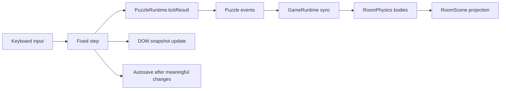

# Concurrency topology contract

The engine upgrade runs in a single browser event loop with a fixed 60 Hz
simulation step. Source ADRs: ADR-0001, ADR-0002, ADR-0004, ADR-0005, ADR-0007.

## 1. The graph

There is no worker, background queue, or parallel writer. The fixed-step
simulation is the single writer of puzzle, physics, and save state.

## 2. Queues and capacities

| Queue | Feeds | Capacity |
|---|---|---|
| Puzzle event queue | link evaluation, world sync | drained each tick; bounded by authored links |
| Pulse queue | pulse arrival/resolution | authored pulses in flight; bounded by cooldown/action rate |
| UI listener fan-out | DOM overlays | one update per changed snapshot; deduplicated |
| Save writes | `localStorage` | one autosave per meaningful transition |

## 3. Backpressure behavior

- The fixed step is synchronous; a slow DOM update does not advance the
  simulation. Phaser accumulates delta and runs fixed steps.
- Puzzle event drain has a guard (existing 128-step guard) to prevent link
  loops.
- Autosave is synchronous from the runtime's perspective; it does not block
  rendering beyond the current transition.
- No unbounded queue or background promise is introduced.

## 4. Single-writer serialization

- `PuzzleRuntime` is the only writer of logical gate/prop/condition state.
- `RoomPhysics` is the only writer of Matter bodies and prop physical state.
- `GameRuntime` is the only caller that synchronizes logical state into physics
  after entry, restore, reset, events, and side return.
- `RoomScene` is read-only with respect to game state; it projects
  `RoomSimulation` and `RuntimeSnapshot`.
- `ui` is read-only with respect to game state; it calls runtime callbacks.
- `save` is a snapshot writer, not a state authority.

## 5. Invariants

- At most one puzzle event drain runs per fixed step.
- Gate/prop synchronization happens after puzzle evaluation and before the next
  player step.
- A side excursion has at most one `returnTo` snapshot.
- No UI callback mutates puzzle or physics state directly.
- No unbounded buffer, timer, or promise is introduced by the upgrade.
