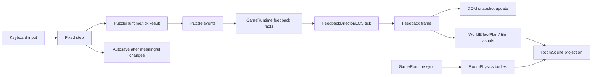

# Concurrency topology contract

The engine upgrade runs in a single browser event loop with a fixed 60 Hz
simulation step. Source ADRs: ADR-0001, ADR-0002, ADR-0004, ADR-0005, ADR-0007,
ADR-0009–0013.
Optional online co-op amendment: ADR-0047, ADR-0048, ADR-0053.

## 1. The graph

There is no worker, background queue, or parallel writer. The fixed-step
simulation is the single writer of puzzle, physics, and save state. Feedback
ticks and effect production run synchronously inside the same step and only
produce presentation data.

### 1.1 Optional online co-op amendment

M4 adds an optional two-player online mode without changing the single-writer
rule:

- the **host browser** continues to run the fixed-step simulation and remains
  the single writer of puzzle, physics, save, and evidence state;
- the guest sends input frames and renders host snapshots; it does not step
  gameplay simulation;
- a Cloudflare Durable Object relays WebSocket messages and stores membership
  only; it is not a game loop, a state store, or a second writer;
- the host’s `visibilitychange`, guest reconnect, and host disconnect paths pause
  or end the session rather than running a concurrent simulation.

This exception applies only to the optional online session. Local
single-player and local co-op remain single-browser, single-writer systems. See
[`ADR-0047`](../../adr-online/0047-host-authoritative-thin-client.md),
[`ADR-0048`](../../adr-online/0048-session-topology-room-lifecycle.md), and
[`ADR-0053`](../../adr-online/0053-failure-reconnect-host-lifecycle.md).

## 2. Queues and capacities

| Queue | Feeds | Capacity |
|---|---|---|
| Puzzle event queue | link evaluation, world sync | drained each tick; bounded by authored links |
| Pulse queue | pulse arrival/resolution | authored pulses in flight; bounded by cooldown/action rate |
| UI listener fan-out | DOM overlays | one update per changed snapshot; deduplicated |
| Save writes | `localStorage` | one autosave per meaningful transition |

## 3. Backpressure behavior

- The fixed step is synchronous; a slow DOM update does not advance the
  simulation. Phaser accumulates delta and runs fixed steps.
- Puzzle event drain has a guard (existing 128-step guard) to prevent link
  loops.
- Autosave is synchronous from the runtime's perspective; it does not block
  rendering beyond the current transition.
- No unbounded queue or background promise is introduced.

## 4. Single-writer serialization

- `PuzzleRuntime` is the only writer of logical puzzle state.
- `RoomPhysics` is the only writer of Matter bodies and prop physical state.
- `GameRuntime` is the only caller that synchronizes logical state into physics
  after entry, restore, reset, and events; side return is deferred.
- `FeedbackDirector` is the only writer of feedback ECS entities, cues, and
  effect instances.
- `RoomScene` is read-only with respect to game state; it projects
  `RoomSimulation`, `RuntimeSnapshot`, `WorldEffectPlan`, and tile visuals.
- `ui` is read-only with respect to game state; it calls runtime callbacks.
- `save` is a snapshot writer, not a state authority.
- Feedback/cues/effects never write puzzle, physics, or collision state.

## 5. Invariants

- At most one puzzle event drain runs per fixed step.
- Feedback ingestion/projection and effect spawning happen once per fixed step.
- Gate/prop synchronization happens after puzzle evaluation and before the next
  player step.
- A side excursion would have at most one `returnTo` snapshot; side travel is
  deferred.
- No UI callback mutates puzzle, physics, or collision state directly.
- No effect plan can mutate puzzle, physics, or collision state.
- No unbounded buffer, timer, or promise is introduced by the upgrade.
