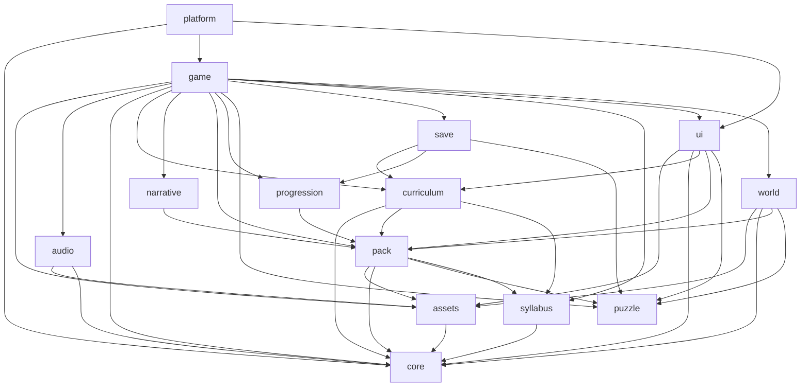

# Module boundaries contract

The per-system record of every module, its public API, and the dependency
graph. Normative per the base model (ADR-0001): modules are sealed by default
and expose only defined public APIs. Source ADRs: ADR-0001 and the module
specific ADRs 0002–0008.

## 1. Modules

Anything **not** listed in “Public API” is private and unreachable from other
modules.

| Module | Owns (concern) | Public API (defined operations) | Hidden internals |
|---|---|---|---|
| `core` | shared result/logging/learning-event primitives | `Result`, `ok`, `err`, `silentLogger`, `LearningEventType`, `isLearningEventType` | helpers, constants, logger implementation |
| `syllabus` | syllabus parsing and lookups | `parseSyllabus`, `objectiveById`, `conceptById`, `prerequisites`, syllabus types | validation tables, warnings |
| `assets` | logical asset resolution and preload | `createAssets`, `AssetsModule`, `AssetId`, `PreloadPlan`, `PLAYER_ASSET_IDS`, `parseManifest` | provider chain, texture caches |
| `puzzle` | pure typed dataflow, gate/prop/condition state | `PuzzleRuntime`, `createPuzzleRuntime`, `validatePuzzleDocument`, `replaySolution`, `PUZZLE_SCHEMA_VERSION`, document/state/event types | node maps, tick ordering, counters, pulse queue |
| `pack` | parse/validate content and mapping | `parsePack`, `parseLevel`, `parseRoom`, `parseDialogue`, `parseGate`, `parsePuzzle`, `parseTheme`, `parseMapping`, `parseLicences`, `validatePack`, `buildMapping`, `normalizeMapping`, content types | file discovery, reference checks, mapping diff |
| `progression` | abilities, flags, gates, level graph, map views | `createProgression`, `hasAbility`, `unlockAbility`, `setFlag`, `flagValue`, `solveGate`, `isGateSolved`, `gateIsOpen`, `buildLevelGraph`, `reachableLevels`, `mapNodes`, `mapEdges`, progression types | snapshot normalization |
| `narrative` | dialogue graph and session | `startDialogue`, `advanceDialogue`, `chooseDialogueOption`, `currentNode`, `conditionMet`, dialogue types | session history, choice records |
| `curriculum` | evidence, debrief prompts, export | `createCurriculum`, `recordEvent`, `eventMatches`, `evidenceForObjective`, `evidenceSummary`, `debriefPrompts`, `exportEvidence`, `resetProgress` | filter matching, prompt derivation |
| `save` | run and settings persistence | `createSave`, `SaveModule`, `RunSnapshot`, `RunLoadResult`, `RUN_SCHEMA_VERSION`, `SAVE_SCHEMA_VERSION`, `MemorySaveStorage` | storage parsing, version checks, settings |
| `audio` | cue/music playback | `createAudio`, `AudioModule`, audio settings types | synth/file providers, unlock |
| `ui` | DOM HUD, overlays, map travel, debrief | `mountGameUi`, `RuntimeSnapshot`, view types, `GameUiCallbacks` | DOM construction, focus, overlays |
| `world` | Matter.js simulation and Phaser projection | `createRoomSimulation`, `stepRoomSimulationWithCues`, `emptyIntents`, `RoomSimulation`, `RoomPhysics`, `RoomScene`, `createGame`, `roomPixelWidth`, `roomPixelHeight`, `TETHER_DISTANCE` | bodies, constraints, sprites, camera, physics timestep |
| `game` | orchestration, lifecycle, sync, feedback, travel | `GameRuntime`, `RuntimeOptions`, `AudioPort`, `RuntimeSavePort`, `RuntimeInput`, `RuntimeActionInput` | puzzle maps, sync point, activation, debrief state, return snapshot |
| `platform` | browser boot and adapters | `bootGame`, `BootResult`, `BootOptions` | DOM canvas, storage/audio wiring, scene restart callback |

### 1.1 New operations introduced by this upgrade

| Module | Operation | Purpose | Source ADR |
|---|---|---|---|
| `puzzle` | `PuzzleRuntime.nodeState(id)` | Read gate/prop/relay/condition state | 0002, 0004, 0005 |
| `puzzle` | `PuzzleRuntime.propState(propId)` | Read the logical prop state | 0004 |
| `puzzle` | `PuzzleRuntime.isGateOpen(gateId)` | Convenience gate query | 0002 |
| `puzzle` | `PuzzleRuntime.tickResult(snapshot)` | Emits `propReleased`, `propCleared`, `linkBlocked` | 0004, 0005 |
| `puzzle` | `replaySolution(document)` | Applies prop events to mock props | 0004 |
| `pack` | `parsePuzzle` / `validatePuzzleDocument` | Validate `initial`, `requires`, `message`, `unlock`, `clear` | 0004, 0005, 0008 |
| `pack` | `parseLevel` / `validatePack` | Validate `debrief`, `kind`, gate body/sprites, prompt/evidence match | 0002, 0003, 0006, 0007, 0008 |
| `world` | `RoomPhysics.setGateOpen(gateId, open)` | Toggle a gate body | 0002 |
| `world` | `RoomPhysics.gateStates()` | Read gate state for presentation | 0002, 0003 |
| `world` | `RoomPhysics.setPropState(propId, state)` | Sync locked/cleared/initial state | 0004 |
| `world` | `RoomPhysics.releaseProp(propId)` | Make a locked prop dynamic/free | 0004 |
| `world` | `RoomPhysics.clearProp(propId)` | Hide/disable a cleared prop | 0004 |
| `world` | `RoomSimulation.gateStates` | Scene projection input | 0002, 0003 |
| `game` | `GameRuntime.travelToSideLevel(levelId)` | Capture return snapshot and enter a side level | 0007 |
| `game` | `RuntimeOptions.onLevelChange` | Notify platform to rebuild the room scene | ADR-0046 |
| `game` | `GameRuntime.debriefPromptList()` | Return level override or syllabus fallback | 0006 |
| `curriculum` | `debriefPrompts(syllabus, objectiveIds, overrides?)` | Build prompts with optional level overrides | 0006 |
| `ui` | `GameUiCallbacks.onMapTravel(levelId)` | Keyboard map travel action | 0007 |
| `save` | `RunSnapshot.returnTo` | Persist the main level during a side excursion | 0007 |
| `save` | `PropSnapshot.state` | Persist `locked`/`cleared` | 0004 |

## 2. Dependency graph

- Every edge targets a module's public API, never its internals.
- The graph is acyclic.
- Leaf modules (`core`, `puzzle`, `syllabus`, `assets`) hold pure/deterministic
  or adapter-local logic. `puzzle` deliberately has no out-edges.
- `game` is the only orchestrator allowed to combine puzzle, world, save,
  curriculum, and UI state.

## 3. Public API signatures

Precise new signatures are in [`interface.md`](interface.md). The full
existing signatures remain in the source modules and are not duplicated here.
The upgrade adds no new module and no new package.

## 4. Invariants

- No cross-module dependency reaches outside a defined public API.
- `puzzle` never imports Matter.js, Phaser, the DOM, `pack`, `world`, `game`,
  `save`, `curriculum`, or `ui`.
- `world` never imports `game`, `save`, `curriculum`, or `ui`.
- Only `game` writes gate/prop synchronization state; `world` exposes
  operations, `ui` reads snapshots, and `puzzle` owns logical state.
- The dependency graph is acyclic.
- Every new operation is tested at its module boundary.
