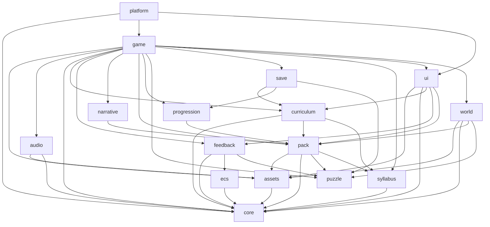

# Module boundaries contract

The per-system record of every module, its public API, and the dependency
graph. Normative per the base model (ADR-0001): modules are sealed by default
and expose only defined public APIs. Source ADRs: ADR-0001, the module-specific
ADRs 0002–0008, and the feedback modules ADR-0009–0013.

Accepted decisions are not all implemented. The implementation status table in
[`architecture.md`](../architecture.md) is authoritative; this contract records
the module boundary that applies to the implemented code and the deferred
targets.

## 1. Modules

Anything **not** listed in “Public API” is private and unreachable from other
modules.

| Module | Owns (concern) | Public API (defined operations) | Hidden internals |
|---|---|---|---|
| `core` | shared result/logging/learning-event primitives | `Result`, `ok`, `err`, `silentLogger`, `LearningEventType`, `isLearningEventType` | helpers, constants, logger implementation |
| `ecs` | deterministic entity/component/system kernel | `createEcsWorld`, `createEntityId`, `defineComponent`, `EntityId`, `ComponentType`, `EcsWorld`, system/context types | component stores, insertion order, system registration |
| `feedback` | capability feedback, cues, effects, conversations as surfaces | `createFeedbackDirector`, `projectSignal`, `NODE_FEEDBACK`, `LINK_FEEDBACK`, `CAPABILITY_DEFAULTS`, `EFFECT_PRESETS`, `effectPresetIds`, `NODE_EFFECT_SOCKETS`, feedback types | ECS components, projection, cue dedupe/TTL, effect instances |
| `syllabus` | syllabus parsing and lookups | `parseSyllabus`, `objectiveById`, `conceptById`, `prerequisites`, syllabus types | validation tables, warnings |
| `assets` | logical asset resolution and preload | `createAssets`, `AssetsModule`, `AssetId`, `PreloadPlan`, `PLAYER_ASSET_IDS`, `parseManifest` | provider chain, texture caches |
| `puzzle` | pure typed dataflow, gate/prop/condition state | `PuzzleRuntime`, `createPuzzleRuntime`, `validatePuzzleDocument`, `replaySolution`, `PUZZLE_SCHEMA_VERSION`, document/state/event types | node maps, tick ordering, counters, pulse queue |
| `pack` | parse/validate content and mapping | `parsePack`, `parseLevel`, `parseRoom`, `parseDialogue`, `parseGate`, `parsePuzzle`, `parseTheme`, `parseMapping`, `parseLicences`, `validatePack`, `FeedbackValidationVocabulary`, `buildMapping`, `normalizeMapping`, content types | file discovery, reference checks, feedback/tile checks, mapping diff |
| `progression` | abilities, flags, gates, level graph, map views | `createProgression`, `hasAbility`, `unlockAbility`, `setFlag`, `flagValue`, `solveGate`, `isGateSolved`, `gateIsOpen`, `buildLevelGraph`, `reachableLevels`, `mapNodes`, `mapEdges`, progression types | snapshot normalization |
| `narrative` | dialogue graph and session | `startDialogue`, `advanceDialogue`, `chooseDialogueOption`, `currentNode`, `conditionMet`, dialogue types | session history, choice records |
| `curriculum` | evidence, debrief prompts, export | `createCurriculum`, `recordEvent`, `eventMatches`, `evidenceForObjective`, `evidenceSummary`, `debriefPrompts`, `exportEvidence`, `resetProgress` | filter matching, prompt derivation |
| `save` | run and settings persistence | `createSave`, `SaveModule`, `RunSnapshot`, `RunLoadResult`, `RUN_SCHEMA_VERSION`, `SAVE_SCHEMA_VERSION`, `MemorySaveStorage` | storage parsing, version checks, settings |
| `audio` | cue/music playback | `createAudio`, `AudioModule`, audio settings types | synth/file providers, unlock |
| `ui` | DOM HUD, overlays, anchored feedback surfaces, debrief | `mountGameUi`, `RuntimeSnapshot`, view types, feedback surface renderer, `GameUiCallbacks` | DOM construction, focus, live region, layout, overlays |
| `world` | Matter.js simulation, Phaser projection, effect/tile visual ports | `createRoomSimulation`, `stepRoomSimulationWithCues`, `emptyIntents`, `RoomSimulation`, `RoomPhysics`, `RoomScene`, `createGame`, `roomPixelWidth`, `roomPixelHeight`, `TETHER_DISTANCE`, `WorldEffectPort`, `TileVisualPort`, `simplifyForReducedMotion` | bodies, constraints, sprites, camera, effect layers, tile visual store |
| `game` | orchestration, lifecycle, feedback facts/conversations, effect mapping | `GameRuntime`, `RuntimeOptions`, `AudioPort`, `RuntimeSavePort`, `RuntimeInput`, `RuntimeActionInput`, `routeSurfaceInput`, effect mapper | puzzle maps, sync point, activation, debrief state, conversation map, effect plans |
| `platform` | browser boot and adapters | `bootGame`, `BootResult`, `BootOptions` | DOM canvas, storage/audio wiring, scene restart callback |

### 1.1 New operations introduced by this upgrade

| Module | Operation | Purpose | Source ADR | Status |
|---|---|---|---|---|
| `puzzle` | `PuzzleRuntime.nodeState(id)` | Read gate/prop/relay/condition state | 0002, 0004, 0005 | Implemented |
| `puzzle` | `PuzzleRuntime.propState(propId)` | Read the logical prop state | 0004 | Implemented |
| `puzzle` | `PuzzleRuntime.isGateOpen(gateId)` | Convenience gate query | 0002 | Implemented |
| `puzzle` | `PuzzleRuntime.tickResult(snapshot)` | Emits `propCleared`; `propReleased`/`linkBlocked` are deferred | 0004, 0005 | Partial |
| `puzzle` | `replaySolution(document)` | Applies prop events to mock props | 0004 | Implemented |
| `puzzle` | `clear` link / `propCleared` event | Clear a prop and emit the event | 0004 | Implemented |
| `pack` | `parsePuzzle` / `validatePuzzleDocument` | Validate implemented fields; deferred fields are not in the schema | 0004, 0005, 0008 | Partial |
| `pack` | `validatePack({ feedbackVocabulary })` | Validate feedback references, labels, sockets, tile targets, and presets without importing `feedback` | 0008, 0012, 0013 | Implemented |
| `world` | `RoomPhysics.clearProp(propId)` / `resetProp(propId)` | Hide/restore a cleared prop | 0004 | Implemented |
| `world` | `RoomPhysics.setGateOpen` / `gateStates` | Physical gate body synchronization | 0002, 0003 | Deferred |
| `world` | `RoomPhysics.setPropState` / `releaseProp` | Locked/initial prop synchronization | 0004 | Deferred |
| `game` | `RuntimeOptions.onLevelChange` | Notify platform to rebuild the room scene | ADR-0046 | Implemented |
| `game` | `GameRuntime.debriefPromptList()` | Return syllabus-derived debrief prompts | 0006 | Implemented (fallback only) |
| `game` | `GameRuntime.travelToSideLevel(levelId)` | Capture return snapshot and enter a side level | 0007 | Deferred |
| `curriculum` | `debriefPrompts(syllabus, objectiveIds)` | Build syllabus-derived prompts | 0006 | Implemented |
| `curriculum` | `debriefPrompts(..., overrides)` | Level prompt overrides | 0006 | Deferred |
| `ui` | `GameUiCallbacks.onMapTravel(levelId)` | Keyboard map travel action | 0007 | Deferred |
| `ui` | `mountFeedbackSurfaces` / surface renderer | Anchored surfaces, beats, live region, surface actions | 0010, 0011 | Implemented |
| `ecs` | `createEcsWorld` / `defineComponent` / `createEntityId` | Generic deterministic kernel | 0009 | Implemented |
| `feedback` | `createFeedbackDirector` / `projectSignal` | Facts, projection, cues, effects | 0009, 0012, 0013 | Implemented |
| `feedback` | `NODE_FEEDBACK` / `LINK_FEEDBACK` / `CAPABILITY_DEFAULTS` | Exhaustive descriptor coverage | 0012 | Implemented |
| `feedback` | `EFFECT_PRESETS` / `effectPresetIds` / `NODE_EFFECT_SOCKETS` | Named cosmetic recipes and conventional sockets | 0013 | Implemented |
| `game` | `routeSurfaceInput` / `SurfaceInputRouter` | Per-player soft-surface input routing | 0010 | Implemented |
| `game` | `GameRuntime.conversations` / `startConversation` | Concurrent entity conversations | 0011 | Implemented |
| `world` | `WorldEffectPort` / `TileVisualPort` / `simplifyForReducedMotion` | Narrow cosmetic rendering ports | 0013 | Implemented |
| `save` | `RunSnapshot.conversations` | Persist conversation sessions; feedback ECS state stays ephemeral | 0011 | Implemented |
| `save` | `RunSnapshot.returnTo` | Persist the main level during a side excursion | 0007 | Deferred |
| `save` | `PropSnapshot.state` | Persist `cleared`; `locked` is deferred | 0004 | Partial |

### 1.2 Proposed online co-op modules (M4)

M4 introduces two new modules. They are not implemented by the M1.75/M1.8
milestones and are listed here so the boundary is decided before code.

| Module | Owns (concern) | Public API (proposed) | Hidden internals |
|---|---|---|---|
| `net` | room transport, protocol, host/guest session | `RoomTransport`, `HostSession`, `GuestSession`, `NetWorld`, `NetInput`, `NetAction`, protocol codec | WebSocket timers, reconnect backoff, sequence tracking |
| `worker` (outside `src/`) | Cloudflare Worker and Durable Object relay | `/ws` route, `GameRoom` DO, room membership | socket attachments, room code normalization, hibernation |

Rules:

- `net` may import `game`, `world`, `save`, and `ui` **view types**; it must not
  become a second game runtime.
- `game` and `world` must not import `net`. The online host/guest adapters are
  injected by `platform`, preserving the existing acyclic graph.
- `worker` never imports `src/game`, `src/world`, or `src/puzzle`; it only
  validates/relays envelopes.
- The host browser remains the single writer; `net` and `worker` do not own
  game state.
- The `worker` directory is deployed separately and is not part of the Vite
  client bundle.
- Terraform, if introduced under `infra/terraform/`, owns account-level
  resources only; it is outside the module graph and does not own Worker code,
  bindings, or the DO class (ADR-0057).

## 2. Dependency graph

- Every edge targets a module's public API, never its internals.
- The graph is acyclic.
- Leaf modules (`core`, `puzzle`, `syllabus`, `assets`) hold pure/deterministic
  or adapter-local logic. `puzzle` deliberately has no out-edges; `ecs` only
  depends on `core`.
- `game` is the only orchestrator allowed to combine puzzle, feedback, world,
  save, curriculum, and UI state.
- `pack` never imports `feedback`. `validatePack` receives a structural
  `FeedbackValidationVocabulary` built by the caller.
- `world` never imports `feedback`; effects enter through `WorldEffectPlan` and
  `TileVisualOp` ports.
- Proposed M4: `platform` injects a `net` host/guest adapter into `game`/`world`
  consumers. `net` may read public view types but adds no edge from `game` or
  `world` back to `net`; the Cloudflare `worker` is outside the client module
  graph. See [ADR-0047–0057](../../adr-online/README.md).

## 3. Public API signatures

Precise new signatures are in [`interface.md`](interface.md). The full
existing signatures remain in the source modules and are not duplicated here.
M1.75 adds the `ecs` and `feedback` modules; it adds no new package. M1.8
material/pattern work remains planned. The proposed M4 online co-op adds `net`
and an out-of-tree `worker`; see §1.2.

## 4. Invariants

- No cross-module dependency reaches outside a defined public API.
- `puzzle` never imports Matter.js, Phaser, the DOM, `pack`, `world`, `game`,
  `save`, `curriculum`, `ui`, or `feedback`.
- `ecs` depends only on `core` and carries no game, puzzle, feedback, DOM,
  Phaser, or Matter types.
- `feedback` imports only `core`, `ecs`, and `puzzle`; it never imports
  `world`, `game`, `ui`, or `pack`.
- `world` never imports `game`, `save`, `curriculum`, `ui`, or `feedback`.
- `pack` never imports `feedback`; its feedback vocabulary is injected.
- `ui` may import feedback types and vocabulary, but not puzzle internals.
- Only `game` writes gate/prop synchronization state; `world` exposes
  operations, `ui` reads snapshots, and `puzzle` owns logical state.
- Feedback and cosmetic effects never mutate puzzle, world, or collision state.
- The dependency graph is acyclic.
- Every new operation is tested at its module boundary.
